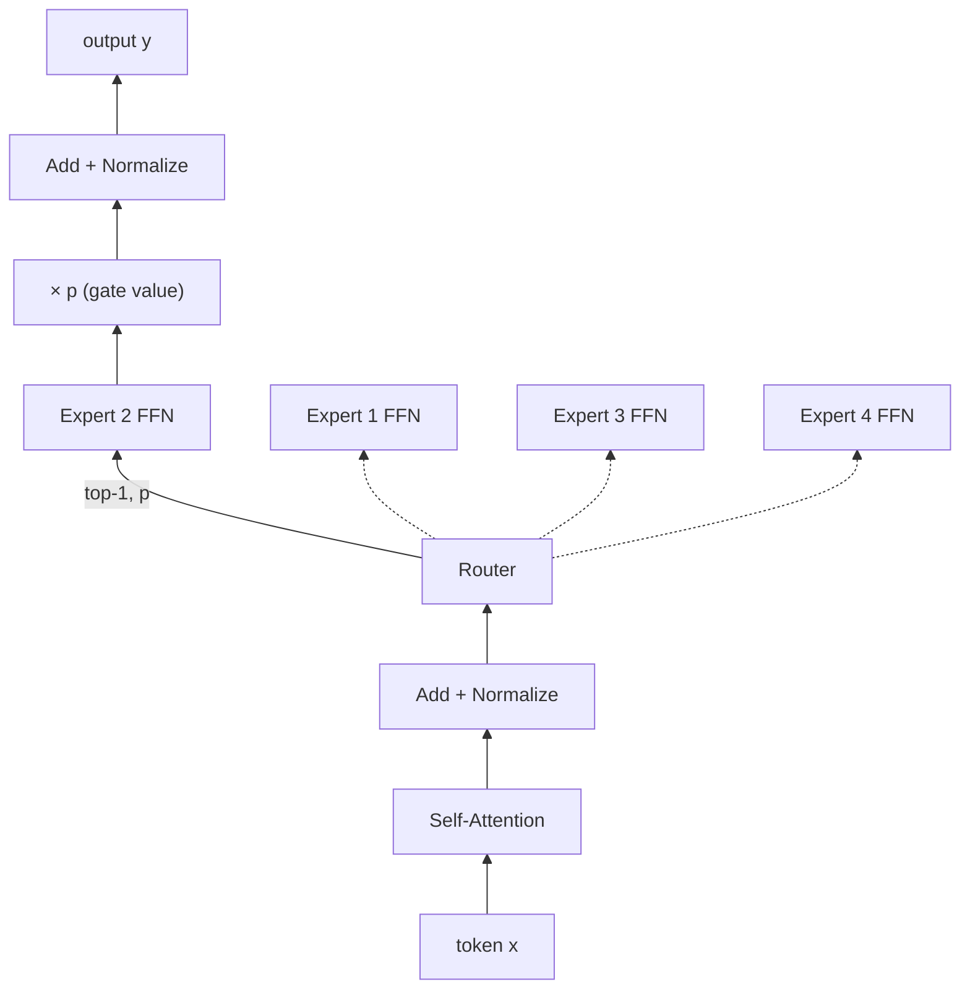

# Switch Transformers: Scaling to Trillion Parameter Models with Simple and Efficient Sparsity

## 메타 정보

| 항목 | 내용 |
|------|------|
| 저자 | William Fedus\*, Barret Zoph\*, Noam Shazeer (\*equal contribution) |
| 소속 | Google |
| 연도 | 2021 (arXiv) / 2022 (JMLR 23) |
| 논문 링크 | [arXiv](https://arxiv.org/abs/2101.03961) · [JMLR](http://jmlr.org/papers/v23/21-0998.html) |
| 코드 | [google-research/t5x](https://github.com/google-research/t5x) (JAX, 체크포인트 포함) · [mesh_tensorflow/moe.py](https://github.com/tensorflow/mesh/blob/master/mesh_tensorflow/transformer/moe.py) (TensorFlow) |
| 키워드 | Mixture-of-Experts, Sparsity, Conditional Computation, Scaling, Distributed Training |

## 한 줄 요약

> token마다 1명의 expert만 쓰는 단순한 MoE 라우팅으로, 연산량은 그대로 두고 파라미터를 1조 개 이상으로 늘려 T5보다 최대 7배 빠르게 학습하는 Switch Transformer.

## 1. 문제의식 / 기존 한계

- 일반적인 딥러닝 모델은 모든 입력에 같은 파라미터를 쓰지만, Mixture of Experts(MoE)는 입력마다 다른 파라미터를 선택한다. 그 결과 파라미터 수는 매우 크면서도 연산량은 일정한 sparse 모델이 된다. 그러나 MoE는 복잡성, 통신 비용, 학습 불안정성 때문에 널리 쓰이지 못했다.
- **Dense 스케일링의 비용:** GPT-3, T5처럼 dense Transformer를 키우는 방식은 효과적이지만, 파라미터를 늘리는 만큼 연산량도 함께 늘어난다.
- **기존 MoE의 구체적 문제:**
  - top-k(k ≥ 2) 라우팅을 써서 token당 여러 expert를 거치므로 연산·통신 비용이 크다.
  - router의 softmax가 bfloat16 같은 저정밀도에서 불안정해, 기존 연구(GShard)는 전체를 float32로 학습했다.
  - 파라미터가 많아 작은 다운스트림 데이터셋에서 과적합되기 쉽다.
- **하드웨어 제약:** 라이브러리와 가속기(GPU/TPU)는 dense 행렬 곱에 맞춰져 있어 sparse 연산을 효율적으로 돌리기 어렵다.

## 2. 핵심 아이디어

- **"연산량은 그대로, 파라미터만 늘린다."** 모델 크기·데이터·연산량에 이어, **token당 FLOPs를 고정한 채 파라미터 수만 늘리는 것**을 별도의 스케일링 축으로 제안한다.
- **top-1 라우팅 (Switch layer):** 기존 MoE는 router 학습에 최소 2개 expert 비교가 필요하다고 봤지만(Shazeer et al., 2017), 각 token을 **expert 1명에게만** 보내도 품질이 유지되고 더 빠르다는 것을 보였다.
- **k = 1의 이점:**
  1. router 연산 감소
  2. expert capacity를 최소 절반으로 줄일 수 있음
  3. 구현이 단순해지고 통신 비용 감소
- expert 수를 늘려도 token은 여전히 1개 expert만 거치므로, router의 가벼운 연산(O(d_model × expert 수))을 빼면 연산량이 거의 변하지 않는다.

## 3. 방법론

### 3.1 전체 구조

Transformer 블록의 dense FFN 층을 **Switch FFN 층**으로 교체한다. Router가 token마다 expert 확률을 계산해 가장 높은 expert로 보내고, 그 출력에 확률(gate value)을 곱해 반환한다. Switch 층은 FFN 층 하나 걸러 하나씩 배치한다(Switch-C는 모든 층).

<!-- 다이어그램:  — 논문 Figure 2 -->

### 3.2 핵심 수식

**Router 확률과 Switch 출력** ($N$: expert 수, $W_r$: router 가중치):

$$
p_i(x) = \frac{e^{h(x)_i}}{\sum_{j=1}^{N} e^{h(x)_j}}, \qquad h(x) = W_r \cdot x
$$

$$
i^* = \arg\max_i \, p_i(x), \qquad y = p_{i^*}(x)\, E_{i^*}(x)
$$

- gate value $p_{i^*}(x)$를 곱하기 때문에 top-1이어도 router가 미분 가능하다. argmax만 쓰고 $p_{i^*}$를 곱하지 않으면 router로 gradient가 흐르지 않는다.
- softmax는 **N개 expert 전체**에 대해 계산한 뒤 1개를 고른다. 따라서 $p_{i^*}(x) < 1$이며, 출력 크기가 router 확신도에 따라 달라진다. (Mixtral은 반대로 상위 2개만 남긴 뒤 softmax를 한다 → [Mixtral 노트](../02-mixtral-of-experts/README.md))

**Expert capacity:**

$$
\text{expert capacity} = \frac{\text{tokens per batch}}{\text{number of experts}} \times \text{capacity factor}
$$

**Load balancing loss** ($f_i$: expert i로 실제 보내진 token 비율, $P_i$: expert i에 할당된 router 확률의 평균):

$$
\mathcal{L}_{aux} = \alpha \cdot N \cdot \sum_{i=1}^{N} f_i \cdot P_i, \qquad \alpha = 10^{-2}
$$

$f_i$와 $P_i$가 모두 $1/N$(균등 분배)일 때 최소가 된다. $f_i$는 미분 불가능하지만 $P_i$가 미분 가능해 학습이 된다.

### 3.3 세부 기법

- **Expert capacity와 token drop:** TPU는 텐서 크기가 정적이어야 하므로 expert마다 처리할 token 수를 고정한다. 용량을 넘친 token은 처리되지 않고 residual connection으로 다음 층에 그대로 전달된다. capacity factor를 키우면 drop은 줄지만 연산·메모리 낭비가 늘어난다. 실험에서 drop 비율은 보통 1% 미만이었다.
- **Selective precision:** router 내부 연산만 float32로 하고, 출력(dispatch/combine 텐서)은 다시 bfloat16으로 바꾼다. 비싼 float32 텐서를 all-to-all 통신으로 보내지 않으면서 안정성을 얻는다.
- **작은 초기화:** 가중치 초기화 스케일을 기본값(s = 1.0)의 0.1배로 줄인다.
- **Expert dropout:** 파인튜닝 시 expert 층에는 dropout 0.4, 나머지 층에는 0.1을 준다.
- **Router 탐색:** 학습 중 router 입력에 곱셈형 jitter 노이즈를 넣는다(argmax, softmax 샘플링, input dropout보다 좋았음).
- **병렬화:** data, model, expert parallelism을 조합한다. Switch-C는 expert + data parallelism만, Switch-XXL은 model parallelism까지 함께 사용한다.

## 4. 실험

### 4.1 설정

- **모델/파라미터 규모:**

  | 모델 | 파라미터 | FLOPs/seq | 전문가 수 | FLOP 매칭 대상 |
  |------|----------|-----------|-----------|----------------|
  | Switch-Base | 7B | 124B | 128 | T5-Base (0.2B) |
  | Switch-Large | 26B | 425B | 128 | T5-Large (0.7B) |
  | Switch-XXL | 395B | 6.3T | 64 | T5-XXL (11B) |
  | Switch-C | 1571B | 890B | 2048 | — (expert 병렬화만 사용) |

- **데이터셋:**
  - 사전학습: C4, T5와 같은 span corruption 목적 함수(token의 15%를 가리고 sentinel token으로 대체해 복원). 다국어는 mC4 (101개 언어)
  - 파인튜닝: GLUE, SuperGLUE, SQuAD, CNNDM, XSum, ARC, ANLI, Winogrande, closed-book QA(Natural Questions, Web Questions, TriviaQA)
- **비교 대상(Baseline):** T5-Base / T5-Large / T5-XXL (dense), MoE Transformer (top-2), mT5-Base (다국어)
- **하드웨어:** TPUv3 (기본 비교는 32 코어), Mesh-TensorFlow
- **평가 지표:** 사전학습은 negative log perplexity (**클수록 좋음**), 다운스트림은 과제별 정확도·exact match·Rouge-2

### 4.2 주요 결과

**사전학습 속도** (같은 품질 도달 기준)

| 항목 | Baseline | 제안 방법 |
|------|----------|-----------|
| wall-clock 속도 향상 | T5-Base | Switch-Base (64 experts) **7배** |
| step 기준 속도 향상 | T5-Base | Switch-Base (64 experts) **7.5배** |
| wall-clock 속도 향상 (T5-Large가 token당 FLOPs 3.5배) | T5-Large | Switch-Base (64 experts) **2.5배** |
| 같은 perplexity 도달 속도 | T5-XXL | Switch-C(1.6T) **4배** |
| Neg. Log Perp. @500k steps | T5-XXL -1.095 | Switch-XXL **-1.008** |
| 다국어 step 속도 향상 (101개 언어) | mT5-Base | 평균 **5배**, 91% 언어에서 4배 이상, **전 언어 개선** |

**다운스트림 파인튜닝** (논문 Table 5, 같은 token당 FLOPs끼리 비교)

| 과제 | T5-Base | Switch-Base | T5-Large | Switch-Large |
|------|---------|-------------|----------|--------------|
| GLUE | 84.3 | **86.7** | 87.8 | **88.5** |
| SQuAD | 85.5 | **87.2** | 88.1 | **88.6** |
| SuperGLUE | 75.1 | **79.5** | 82.7 | **84.7** |
| Winogrande (XL) | 66.6 | **73.3** | 79.1 | **83.0** |
| XSum | 18.7 | **20.3** | 20.9 | **22.3** |
| ANLI (R3) | 51.7 | **54.0** | 56.6 | **58.6** |
| ARC-Easy | 56.7 | **61.3** | **68.8** | 66.0 |
| ARC-Challenge | **35.5** | 32.8 | 35.5 | 35.5 |
| Closed-book WebQA | 26.6 | **27.4** | 27.7 | **31.3** |
| Closed-book NQ | 25.8 | **26.8** | 27.6 | **29.5** |
| Closed-book TriviaQA | 24.5 | **30.7** | 29.5 | **36.9** |

ARC만 예외였다. ARC-Challenge는 Base에서 T5가 앞서고 Large에서는 같았으며, ARC-Easy는 Large에서 T5가 앞섰다. 반면 closed-book QA처럼 **지식을 묻는 과제**에서 개선폭이 가장 컸다(TriviaQA +6~7점). 파라미터가 늘어난 효과가 지식 저장에 잘 나타난다는 해석과 맞는다.

**증류 (Switch → dense T5-Base 223M)**

| Teacher (Switch) | 파라미터 압축률 | 유지한 품질 향상분 |
|------------------|-----------------|--------------------|
| 1.1B | 82% | **37%** |
| 3.8B | 95% | **30%** |
| 14.7B | 99% | **28%** |

"유지한 품질 향상분"은 Switch teacher가 T5-Base보다 좋아진 정도 중 증류된 dense 모델이 가져간 비율이다. 파인튜닝된 모델 증류에서는 SuperGLUE 기준 T5-Base 74.6 → 증류 모델 **76.6** (teacher Switch-Base 81.3)으로, 향상분의 약 30%를 유지했다.

### 4.3 Ablation / 분석

- **Switch vs MoE (표 1):** 128 experts, 같은 연산량에서 Switch가 속도-품질 모두 우세했다. 특히 capacity factor 1.0~1.25에서 강했고(Switch-Base 1.0: 1000 ex/sec, 임계값 도달 62.8시간 vs MoE 80.1시간), 이는 메모리가 부족한 대형 모델 환경에 유리하다.
- **Selective precision (표 2):**

  | 정밀도 | Neg. Log Perp. | 속도 (ex/sec) |
  |--------|----------------|---------------|
  | float32 | -1.718 | 1160 |
  | bfloat16 | -3.780 (발산) | 1390 |
  | Selective | **-1.716** | **1390** |

- **초기화 스케일 (표 3):** 0.1x 초기화로 품질 -3.60 → -2.72, 시드 간 표준편차 0.68 → 0.01.
- **Expert dropout (표 4):** 모든 층 dropout을 0.3으로 올리면 SuperGLUE가 70.7로 떨어졌지만, expert만 0.4로 올리면 GLUE 84.7 → 85.2로 개선되었다.
- **Expert 수 스케일링:** 1 → 256 experts로 늘릴수록 연산량 동일하게 테스트 손실이 꾸준히 감소(256 experts = 14.7B). 단, 수확 체감이 있다.
- **적은 expert:** expert **2개**만 써도 T5-Base보다 개선되어, 슈퍼컴퓨터 없이도 활용할 수 있다.
- **Router 탐색 (표 11):** input jitter(-1.468) > argmax(-1.471) > input dropout(-1.480) > softmax 샘플링(-1.570).
- **No-Token-Left-Behind:** 넘친 token을 두 번째 expert로 재라우팅했지만 효과가 없었다. 학습된 token-expert 연관이 깨지기 때문으로 추정한다.
- **Attention에 Switch 적용 (부록 A):** float32에서는 품질이 좋아졌지만 bfloat16에서 발산했다.
- **업스트림 vs 다운스트림 (부록 E):** 같은 perplexity에서 지식 과제(TriviaQA)는 Switch가 dense보다 좋았지만, 추론 과제(SuperGLUE)는 대규모에서 dense가 더 좋은 경우가 많았다.

## 5. 한계점 및 이후 연구

- **한계점**:
  - **최대 규모 모델의 불안정성:** 1.6T Switch-C는 안정적이었지만, token당 FLOPs가 약 10배 큰 395B Switch-XXL은 때때로 불안정해 1M step까지 학습하지 못했다.
  - **업스트림 → 다운스트림 전이 격차:** Switch-C는 perplexity가 비슷한데도 SQuAD 87.7로, 파라미터가 4배 적은 Switch-XXL(89.6)보다 낮았다. 파인튜닝 품질, token당 FLOPs, 파라미터 수 사이의 관계가 아직 잘 이해되지 않았다.
  - **SOTA 미달:** Switch-XXL은 사전학습 perplexity는 최고였지만 SuperGLUE(87.5)는 T5-XXL(89.3)에 못 미쳤다. 단, T5-XXL 데이터의 절반만 학습한 체크포인트다.
  - **배포 부담:** 파라미터가 매우 커서 증류가 필요하며, 증류 시 품질 향상분의 약 70%를 잃는다.
  - **TPU 중심 설계:** 정적 텐서 크기 때문에 token drop이 생기고, 실험이 TPU + Mesh-TensorFlow 환경에 맞춰져 있다.
- **후속 연구** (논문이 제시한 방향):
  - 가장 큰 모델의 학습 안정성 개선 (정규화, gradient clipping 변형)
  - data·model·expert 병렬화를 조합한 아키텍처 설계를 위한 스케일링 법칙 연구
  - 크기가 서로 다른 heterogeneous expert (어려운 예제에 더 큰 expert)
  - FFN 외 층(Self-Attention)에 expert 적용
  - 언어 외 모달리티와 멀티모달로 확장
  - attention sparsity(긴 문맥)와의 결합
- **실제 후속 연구**:
  - GLaM (2021): decoder-only top-2 MoE 1.2T. GPT-3보다 학습 에너지는 1/3, 추론 FLOPs는 절반으로 더 좋은 성능
  - ST-MoE (2022): 같은 저자들이 router z-loss로 학습 불안정성 문제를 해결하고, 업스트림-다운스트림 격차를 분석
  - Expert Choice Routing (2022): token이 expert를 고르는 대신 expert가 token을 골라 load imbalance와 token drop 문제를 해결
  - MegaBlocks (2022): block-sparse 연산으로 capacity 제한 없이 token drop 없는(dropless) MoE 학습
  - [Mixtral 8x7B](../02-mixtral-of-experts/README.md) (2024): decoder-only top-2 MoE를 오픈 가중치로 공개해 LLaMA 2 70B급 성능 달성
  - DeepSeekMoE (2024): 더 잘게 나눈 expert(fine-grained)와 shared expert로 expert 전문화 강화

## 6. 내 생각 / 의문점

- 파라미터가 4배 많은 Switch-C가 SQuAD에서 Switch-XXL보다 낮은 이유는 무엇일까? 추론 과제에는 파라미터보다 token당 연산량이 더 중요한 걸까?
- token drop이 1% 미만이라고 했는데, 파인튜닝처럼 배치가 작거나 분포가 치우친 데이터에서도 그럴까?
- top-1 라우팅이 top-2보다 낫다는 결과가 모델 품질 자체 때문인지, 같은 연산 예산에서 더 큰 모델을 쓸 수 있어서인지 구분할 수 있을까?