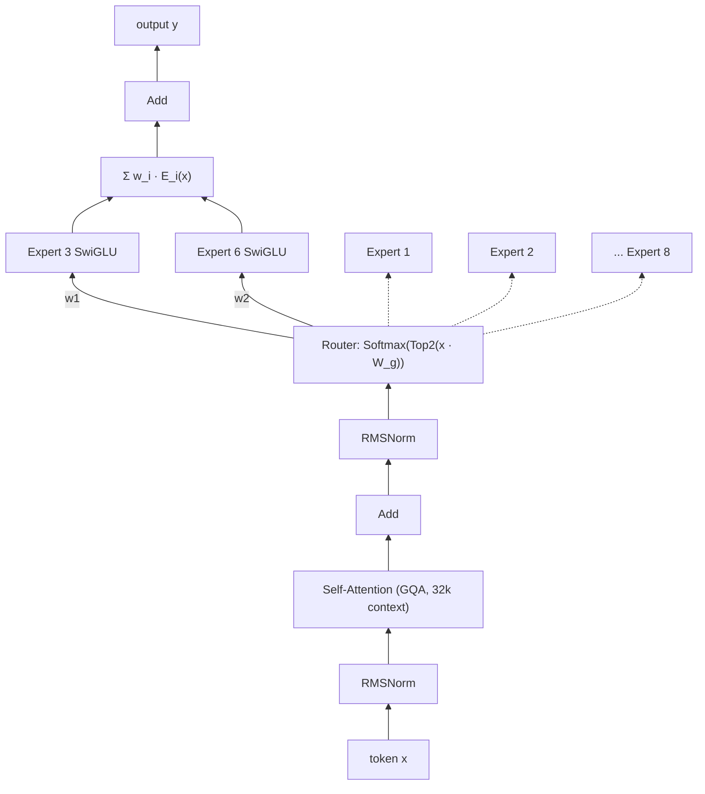

# Mixtral of Experts

## 메타 정보

| 항목 | 내용 |
|------|------|
| 저자 | Albert Q. Jiang, Alexandre Sablayrolles, Antoine Roux, Arthur Mensch, Blanche Savary, Chris Bamford, Devendra Singh Chaplot, Diego de las Casas, Emma Bou Hanna, Florian Bressand, Gianna Lengyel, Guillaume Bour, Guillaume Lample, Lélio Renard Lavaud, Lucile Saulnier, Marie-Anne Lachaux, Pierre Stock, Sandeep Subramanian, Sophia Yang, Szymon Antoniak, Teven Le Scao, Théophile Gervet, Thibaut Lavril, Thomas Wang, Timothée Lacroix, William El Sayed |
| 소속 | Mistral AI |
| 연도 | 2024 (arXiv, 2024.01) / 모델 공개는 2023.12 |
| 논문 링크 | [arXiv](https://arxiv.org/abs/2401.04088) · [블로그](https://mistral.ai/news/mixtral-of-experts/) |
| 코드 | [mistralai/mistral-src](https://github.com/mistralai/mistral-src) (레퍼런스 구현) · 가중치 Apache 2.0 공개 · vLLM + [MegaBlocks](https://github.com/stanford-futuredata/megablocks) 커널로 서빙 |
| 키워드 | Sparse Mixture-of-Experts, Top-2 Routing, Open-weight LLM, Mistral 7B, SwiGLU, Long Context (32k) |

## 한 줄 요약

> Mistral 7B의 FFN을 8개 expert 중 2개만 고르는 Sparse MoE 층으로 바꿔, 전체 47B 파라미터 중 token당 13B만 쓰면서 LLaMA 2 70B·GPT-3.5와 같거나 더 좋은 성능을 내는 오픈 가중치 모델 Mixtral 8x7B.

## 1. 문제의식 / 기존 한계

- **Dense 모델의 비용:** LLaMA 2 70B처럼 dense 모델을 키우면 성능은 오르지만, token마다 모든 파라미터를 쓰므로 추론 비용(연산량·지연시간)이 파라미터 수에 비례해 커진다.
- **MoE는 대부분 연구·비공개 영역:** Switch Transformer, GShard, GLaM 등 MoE 연구는 많았지만, 대부분 Google 내부 TPU 환경의 encoder-decoder 또는 비공개 모델이었다. **실제로 쓸 수 있는 고성능 오픈 가중치 decoder-only MoE**는 사실상 없었다.
- **오픈 모델과 상용 모델의 격차:** 당시 최고 수준의 오픈 모델(LLaMA 2 70B)도 GPT-3.5 수준에는 못 미쳤고, 특히 수학·코드·다국어에서 차이가 컸다.

## 2. 핵심 아이디어

- **"파라미터는 47B, 연산은 13B."** Mistral 7B와 같은 구조에서 각 층의 FFN을 **8개 expert**로 늘리고, router가 token마다 **2개 expert만** 골라 결과를 가중합한다. 모델이 쓸 수 있는 파라미터는 늘리되, token당 연산량은 적게 유지한다.
- **Active 파라미터 대비 효율:** token당 active 파라미터(13B)는 LLaMA 2 70B의 약 1/5인데, 대부분 벤치마크에서 같거나 더 좋다.
- **단순한 설계:** 새 기법을 많이 넣기보다, 검증된 Mistral 7B 아키텍처 + top-2 MoE라는 단순한 조합에 집중했다. 논문의 기여는 새 알고리즘보다 **잘 학습된 오픈 MoE 모델과 그 분석**에 가깝다.
- **Instruct 모델 공개:** SFT + DPO로 학습한 Mixtral 8x7B – Instruct가 당시 사람 평가 기준 GPT-3.5 Turbo, Claude-2.1, Gemini Pro, LLaMA 2 70B chat을 앞섰다.

## 3. 방법론

### 3.1 전체 구조

Mistral 7B와 같은 decoder-only Transformer이며, 차이는 두 가지다.

1. 모든 층의 FFN을 **Sparse MoE 층**(8 experts, top-2)으로 교체
2. Mistral 7B의 sliding window attention 대신 **32k token 전체 문맥을 dense attention**으로 처리

각 token의 hidden state는 router(gating network)를 거쳐 상위 2개 expert로 보내지고, 두 expert(SwiGLU FFN)의 출력을 router 가중치로 더해 다음 층으로 넘긴다. 같은 문장 안에서도 token마다, 층마다 다른 expert를 쓸 수 있다.

<!-- 다이어그램:  — 논문 Figure 1 -->

**아키텍처 하이퍼파라미터 (논문 Table 1)**

| 파라미터 | 값 |
|----------|-----|
| dim | 4096 |
| n_layers | 32 |
| head_dim | 128 |
| hidden_dim (FFN) | 14336 |
| n_heads | 32 |
| n_kv_heads | 8 (GQA) |
| context_len | 32768 |
| vocab_size | 32000 |
| num_experts | 8 |
| top_k_experts | 2 |

### 3.2 핵심 수식

**MoE 층 출력** ($n$개 expert, $G(x)_i$: i번째 expert의 gate 값, $E_i(x)$: i번째 expert 출력):

$$
y = \sum_{i=0}^{n-1} G(x)_i \cdot E_i(x)
$$

$G(x)_i = 0$인 expert는 계산할 필요가 없으므로 연산이 sparse해진다.

**Gating (Top-K 후 Softmax):**

$$
G(x) := \text{Softmax}(\text{TopK}(x \cdot W_g)), \qquad
\text{TopK}(\ell)_i :=
\begin{cases}
\ell_i & \text{if } \ell_i \text{ 가 상위 K개 logit에 속함} \\
-\infty & \text{otherwise}
\end{cases}
$$

**Mixtral의 최종 형태** ($n = 8$, $K = 2$, expert = SwiGLU FFN):

$$
y = \sum_{i=0}^{n-1} \text{Softmax}(\text{Top2}(x \cdot W_g))_i \cdot \text{SwiGLU}_i(x)
$$

- Switch Transformer는 **전체 expert에 softmax를 한 뒤** 1등을 고르지만, Mixtral은 **상위 2개 logit만 남기고 softmax**한다. 따라서 선택된 두 expert의 가중치 합이 항상 1이다.
- $K$를 고정한 채 $n$을 늘리면 전체 파라미터는 늘지만 token당 연산량은 거의 그대로다. 전체 파라미터를 "sparse parameter count", token당 사용하는 파라미터를 "active parameter count"라 부른다.

### 3.3 세부 기법

- **Expert = SwiGLU FFN:** 각 expert는 Mistral 7B의 FFN과 같은 SwiGLU 구조다. attention·embedding 등은 모든 expert가 공유하므로, 전체 파라미터는 8 × 7B = 56B가 아니라 **약 47B**, token당 active 파라미터는 **약 13B**이다.
- **효율적 실행 (MegaBlocks):** expert별로 처리할 token 수가 달라 일반 배치 행렬곱으로는 비효율적이다. MegaBlocks는 MoE FFN 연산을 큰 sparse 행렬곱으로 바꿔 실행 속도를 크게 높이고, 용량 초과로 token을 버리지 않는다(dropless). 오픈소스 vLLM에 이 커널을 통합해 배포했다.
- **Expert Parallelism (EP):** expert를 여러 GPU에 나눠 두고, token을 해당 expert가 있는 GPU로 보내 처리한 뒤 다시 원래 위치로 돌려보낸다. 다만 특정 expert에 token이 몰리면 일부 GPU에 부하가 집중되는 **load balancing 문제**가 생긴다.
- **사전학습:** 다국어 데이터로 32k context 길이에서 학습했다. Mistral 7B 대비 **다국어 데이터 비중을 높였다(upsampling)**. 데이터 구성·규모, 학습 token 수, load balancing loss 사용 여부 등은 공개하지 않았다.
- **Instruction tuning:** 지시 데이터로 SFT 후 쌍 비교 피드백 데이터로 **DPO(Direct Preference Optimization)**를 적용해 Mixtral 8x7B – Instruct를 만들었다.

## 4. 실험

### 4.1 설정

- **모델/파라미터 규모:**

  | 모델 | 전체 파라미터 | Active 파라미터 | 구조 |
  |------|---------------|-----------------|------|
  | Mistral 7B | 7B | 7B | dense |
  | LLaMA 2 7B / 13B / 70B | 7B / 13B / 70B | 7B / 13B / 70B | dense |
  | **Mixtral 8x7B** | **47B** | **13B** | sparse MoE (8 experts, top-2) |

- **데이터셋 (모든 모델을 자체 평가 파이프라인으로 재평가):**
  - 상식 추론 (0-shot): HellaSwag, WinoGrande, PIQA, SIQA, OpenbookQA, ARC-Easy, ARC-Challenge, CommonsenseQA
  - 세계 지식 (5-shot): NaturalQuestions, TriviaQA
  - 독해 (0-shot): BoolQ, QuAC
  - 수학: GSM8K (8-shot, maj@8), MATH (4-shot, maj@4)
  - 코드: HumanEval (0-shot), MBPP (3-shot)
  - 종합: MMLU (5-shot), BBH (3-shot), AGI Eval (3–5-shot, 영어 객관식만)
  - 다국어: 프랑스어·독일어·스페인어·이탈리아어판 ARC-Challenge, HellaSwag, MMLU
  - 긴 문맥: passkey retrieval, proof-pile perplexity
  - 편향: BBQ, BOLD
- **비교 대상(Baseline):** Mistral 7B, LLaMA 2 7B / 13B / 70B, LLaMA 1 33B(다국어), GPT-3.5, Instruct 모델은 GPT-3.5 Turbo, Claude-2.1, Gemini Pro, LLaMA 2 70B chat

### 4.2 주요 결과

**사전학습 모델 비교 (논문 Table 2)** — active 파라미터 13B로 70B 모델과 비교

| 항목 | Mistral 7B | LLaMA 2 70B | Mixtral 8x7B |
|------|-----------|-------------|--------------|
| MMLU | 62.5 | 69.9 | **70.6** |
| HellaSwag | 81.0 | **85.4** | 84.4 |
| WinoGrande | 74.2 | **80.4** | 77.2 |
| PIQA | 82.2 | 82.6 | **83.6** |
| ARC-Easy | 80.5 | 79.9 | **83.1** |
| ARC-Challenge | 54.9 | 56.5 | **59.7** |
| NaturalQuestions | 23.2 | 25.4 | **30.6** |
| TriviaQA | 62.5 | **73.0** | 71.5 |
| HumanEval | 26.2 | 29.3 | **40.2** |
| MBPP | 50.2 | 49.8 | **60.7** |
| MATH (maj@4) | 12.7 | 13.8 | **28.4** |
| GSM8K (maj@8) | 50.0 | 69.6 | **74.4** |

수학·코드에서 격차가 특히 크다(MATH 2배 이상, HumanEval +11%p). HellaSwag, WinoGrande, TriviaQA 같은 상식·지식 과제는 LLaMA 2 70B가 약간 앞선다.

**GPT-3.5와 비교 (논문 Table 3)**

| 항목 | LLaMA 2 70B | GPT-3.5 | Mixtral 8x7B |
|------|-------------|---------|--------------|
| Active 파라미터 | 70B | – | **13B** |
| MMLU (5-shot) | 69.9 | 70.0 | **70.6** |
| HellaSwag (10-shot) | **87.1** | 85.5 | 86.7 |
| ARC-Challenge (25-shot) | 85.1 | 85.2 | **85.8** |
| WinoGrande (5-shot) | **83.2** | 81.6 | 81.2 |
| MBPP (pass@1) | 49.8 | 52.2 | **60.7** |
| GSM8K (5-shot) | 53.6 | 57.1 | **58.4** |
| MT-Bench (Instruct 모델) | 6.86 | **8.32** | 8.30 |

**다국어 (논문 Table 4, ARC-c / HellaSwag / MMLU)**

| 언어 | LLaMA 2 70B | Mixtral 8x7B |
|------|-------------|--------------|
| 프랑스어 | 49.9 / 72.5 / 64.3 | **58.2 / 77.4 / 70.9** |
| 독일어 | 47.3 / 68.7 / 64.2 | **54.3 / 73.0 / 71.5** |
| 스페인어 | 50.5 / 74.5 / 66.0 | **55.4 / 77.6 / 72.5** |
| 이탈리아어 | 49.4 / 70.9 / 65.1 | **52.8 / 75.1 / 70.9** |

다국어 데이터 upsampling 덕분에 4개 언어 모두에서 LLaMA 2 70B보다 좋았다. 영어 성능은 유지됐다.

**긴 문맥**

| 항목 | 결과 |
|------|------|
| Passkey retrieval | context 길이·passkey 위치와 상관없이 **100%** 정확도 |
| proof-pile perplexity | context 길이가 길어질수록 **단조 감소** |

**편향 (BBQ / BOLD)**

| 항목 | LLaMA 2 70B | Mixtral 8x7B |
|------|-------------|--------------|
| BBQ 정확도 | 51.5% | **56.0%** |
| BOLD | — | 평균 sentiment가 더 긍정적이고, 그룹 간 분산은 비슷 |

**Instruct 모델 (사람 평가)**

| 항목 | Baseline | 제안 방법 |
|------|----------|-----------|
| MT-Bench | GPT-3.5 Turbo 8.32 | Mixtral 8x7B – Instruct **8.30** (2023.12 기준 오픈 가중치 1위) |
| LMSys Chatbot Arena Elo | GPT-3.5-Turbo-0613 1117 · Claude-2.1 1117 · Gemini Pro 1111 · LLaMA 2 70B chat 1077 | Mixtral 8x7B – Instruct **1121** |

### 4.3 Ablation / 분석

논문에는 expert 수·top-k 등에 대한 ablation이 없다. 대신 **router가 실제로 무엇을 기준으로 expert를 고르는지**를 분석했다(Section 5).

- **분석 방법:** The Pile 검증 셋의 여러 도메인(ArXiv, PubMed Abstracts, PhilPapers, GitHub, DM Mathematics 등)에서 layer 0, 15, 31의 expert 선택 분포를 비교했다.
- **주제별 전문화는 거의 없음:** 생물학(PubMed), 철학(PhilPapers), 수학·물리(ArXiv) 등 도메인이 달라도 expert 분포에 뚜렷한 차이가 없었다. 예외는 DM Mathematics로 분포가 약간 달랐는데, 합성 데이터라 자연어를 거의 포함하지 않기 때문으로 추정한다. 특히 첫 층과 마지막 층은 입력·출력 임베딩과 가까워 분포 차이가 더 컸다.
- **문법(구문) 구조에 따른 라우팅:** 의미보다 **형태**에 반응했다. 예를 들어 Python의 `self`, 영어의 "Question", 코드의 들여쓰기 token이 여러 문맥에서 같은 expert로 라우팅됐다.
- **연속 token의 지역성 (temporal locality):** 연속된 token이 같은 expert로 가는 비율이 무작위 기대치(첫 번째 선택 기준 1/8 = 12.5%, 상위 2개 중 하나 기준 약 46%)보다 훨씬 높았다. 특히 layer 15, 31 같은 중간·후반 층에서 두드러졌다.
- **실용적 의미:** 지역성은 expert 캐싱이나 배치 처리 최적화에 활용할 수 있다. 반대로 Expert Parallelism에서는 특정 expert에 token이 몰려 GPU 간 부하가 불균형해질 수 있다.
- **크기 대비 효율 (Figure 3):** active 파라미터 대비 성능을 그리면 Mixtral은 LLaMA 2 계열 곡선보다 확실히 위에 있다. 특히 코드·수학·MMLU에서 차이가 크다.

## 5. 한계점 및 이후 연구

- **한계점**:
  - **메모리는 47B 기준:** 연산은 13B만 쓰지만, 모든 expert를 메모리에 올려야 하므로 GPU 메모리는 47B dense 모델과 비슷하게 든다. 단일 소비자 GPU에서 돌리기 어렵다.
  - **Routing 오버헤드와 낮은 배치 효율:** routing과 token 재배치 때문에 장치 활용률이 떨어진다. 배치가 크고 연산 밀도(arithmetic intensity)가 높은 서빙 환경에 더 적합하다.
  - **학습 정보 비공개:** 학습 데이터 구성, 학습 token 수, 연산량, load balancing loss 등 학습 세부사항을 공개하지 않아 재현하기 어렵다.
  - **Ablation 부재:** expert 수, top-k 값, Mistral 7B 초기화 여부(upcycling) 등 설계 선택이 성능에 주는 영향을 보여주지 않는다.
  - **expert 전문화의 해석 한계:** expert가 사람이 이해할 수 있는 주제로 나뉘지 않아, "전문가"라는 이름과 달리 해석 가능성은 낮다.
  - **지식 과제는 우위가 작음:** TriviaQA, HellaSwag, WinoGrande 등에서는 LLaMA 2 70B보다 낮다.
- **후속 연구**:
  - Mixtral 8x22B (2024.04): 같은 구조를 더 크게 확장 (141B 전체 / 39B active, 64k context)
  - DeepSeekMoE: 더 잘게 나눈 expert(fine-grained) + 항상 쓰는 shared expert로 expert 전문화 강화
  - Qwen MoE, DBRX, OLMoE, Grok-1, Llama 4 등 오픈 MoE LLM이 표준 선택지로 자리 잡음
  - Expert offloading·양자화·expert pruning 등 MoE 메모리 문제를 줄이는 추론 최적화 연구

## 6. 내 생각 / 의문점

- Mixtral은 Mistral 7B에서 출발해 FFN을 복제하는 방식(sparse upcycling)으로 초기화했을까, 처음부터 학습했을까? 논문은 이를 밝히지 않는다.
- Switch Transformer는 top-1이 top-2보다 낫다고 했는데, Mixtral은 왜 top-2를 택했을까? decoder-only 대형 모델에서는 top-2의 품질 이점이 연산 비용보다 큰 걸까?
- expert가 주제가 아니라 구문 기준으로 나뉜다면, "도메인 전문가 모델을 합친다"는 MoE의 직관은 실제로 맞지 않는 것 아닐까? fine-grained expert를 쓰면 달라질까?
- load balancing loss나 capacity factor 언급이 없는데, MegaBlocks(dropless) 덕분에 token drop 없이 학습했다면 load balancing은 어떻게 했을까?
- 수학·코드 성능이 크게 오른 이유가 MoE 구조 덕분인지, 학습 데이터 구성 덕분인지 구분할 수 있을까?
