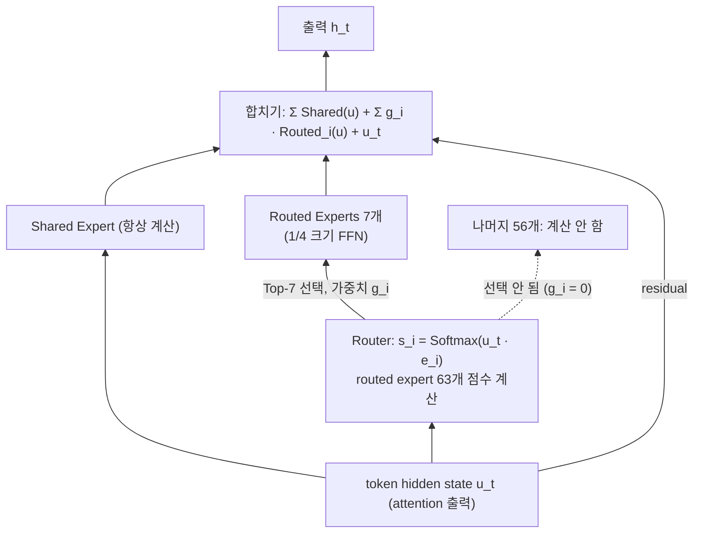

# DeepSeekMoE: Towards Ultimate Expert Specialization in Mixture-of-Experts Language Models

## 메타 정보

| 항목 | 내용 |
|------|------|
| 저자 | Damai Dai, Chengqi Deng, Chenggang Zhao, R.X. Xu, Huazuo Gao, Deli Chen, Jiashi Li, Wangding Zeng, Xingkai Yu, Y. Wu, Zhenda Xie, Y.K. Li, Panpan Huang, Fuli Luo, Chong Ruan, Zhifang Sui, Wenfeng Liang |
| 소속 | DeepSeek-AI, 북경대(Peking University), 칭화대(Tsinghua University), 난징대(Nanjing University) |
| 연도 | 2024 (arXiv, 2024.01) / ACL 2024 |
| 논문 링크 | [arXiv](https://arxiv.org/abs/2401.06066) |
| 코드 | [deepseek-ai/DeepSeek-MoE](https://github.com/deepseek-ai/DeepSeek-MoE) · DeepSeekMoE 16B Base / Chat 가중치 공개 |
| 키워드 | Mixture-of-Experts, Fine-grained Expert Segmentation, Shared Expert Isolation, Expert Specialization, Load Balancing |

## 한 줄 요약

> expert를 **잘게 쪼개서 더 많이 고르고(fine-grained)**, 모든 token이 거치는 **공유 expert(shared)**를 따로 두어, 같은 연산량에서 expert가 더 "전문가답게" 나뉘도록 만든 MoE 구조. 16B 모델이 연산량 약 40%로 DeepSeek 7B·LLaMA 2 7B 수준의 성능을 낸다.

## 1. 문제의식 / 기존 한계

GShard·Switch·Mixtral 같은 기존 MoE는 보통 **큰 expert 8~16개 중 1~2개**를 고른다. 저자들은 이 구조에서 expert가 진짜 "전문가"가 되기 어렵다고 보고, 원인을 두 가지로 정리한다.

- **지식 혼합 (Knowledge Hybridity):** expert 수가 적으면 한 expert에 온갖 종류의 token이 들어온다. 예를 들어 expert가 8개뿐이면, 한 expert가 수학·코드·역사·문법을 동시에 떠안는다. 서로 성격이 다른 지식을 한 파라미터에 욱여넣다 보니 어느 것도 깊게 배우기 어렵다.
- **지식 중복 (Knowledge Redundancy):** 문법, 자주 쓰는 단어 같은 **공통 지식**은 거의 모든 token에 필요하다. 그런데 expert들은 서로 독립적으로 학습되므로, 여러 expert가 같은 공통 지식을 **각자 따로** 배운다. 같은 내용이 여러 번 저장돼 파라미터가 낭비된다.
- 두 문제는 결국 같은 결과로 이어진다. expert가 서로 겹치지 않는 고유한 지식에 집중하지 못하므로, **MoE가 이론적으로 낼 수 있는 성능 상한에 못 미친다.** (참고: [Mixtral 노트](../02-mixtral-of-experts/README.md)의 분석에서도 expert가 주제별로 뚜렷이 나뉘지 않았다.)

## 2. 핵심 아이디어

**"연산량은 그대로 두고, expert를 쪼개고, 공통 지식 담당을 따로 둔다."**

| 아이디어 | 무엇을 바꾸나 | 어떤 문제를 푸나 |
|----------|---------------|------------------|
| ① **Fine-grained Expert Segmentation** (잘게 쪼개기) | expert 하나를 $m$개의 작은 expert로 나누고, 고르는 개수도 $m$배로 늘린다 | 지식 혼합 → 더 좁은 범위의 지식에 집중 |
| ② **Shared Expert Isolation** (공유 expert 분리) | $K_s$개 expert는 router와 상관없이 **모든 token이 항상** 거친다 | 지식 중복 → 공통 지식은 한곳에서만 학습 |

- 두 아이디어 모두 **전체 파라미터 수와 token당 연산량을 바꾸지 않는다.** 같은 예산 안에서 expert를 "어떻게 나누느냐"만 바꾼다.
- 결과: 2B 규모에서 expert 파라미터·연산량이 1.5배인 GShard와 같은 성능을 내고, MoE 성능 상한으로 볼 수 있는 같은 크기의 dense 모델에 거의 도달한다.

## 3. 방법론

### 3.1 전체 구조

#### 기존 MoE와 무엇이 다른가

attention, residual, router 구조는 기존 Top-K MoE와 같다. 다른 것은 **FFN 층 안에서 expert를 나누는 방식**뿐이다. (2B 검증 실험 기준, expert 크기는 표준 FFN을 1로 둔 값)

| | 기존 Top-2 MoE (GShard) | ① + Fine-grained Segmentation | ② + Shared Expert = DeepSeekMoE |
|---|---|---|---|
| expert 크기 | 1 (표준 FFN) | 1/4 (중간 차원 $d_{ff}/4$) | 1/4 |
| expert 수 (공유 + routed) | 0 + 16 | 0 + 64 | 1 + 63 |
| token당 사용 (공유 + routed) | 0 + 2 | 0 + 8 | 1 (항상) + 7 (router 선택) |
| 전체 expert 파라미터 / token당 연산 | 16 / 2 | 16 / 2 (동일) | 16 / 2 (동일) |
| 가능한 expert 조합 수 | $\binom{16}{2} = 120$ | $\binom{64}{8} \approx 4.4 \times 10^9$ | $\binom{63}{7} \approx 5.5 \times 10^8$ |
| 의도한 효과 | — | expert 하나가 맡는 지식 범위가 좁아짐 (지식 혼합 ↓) | 공통 지식을 공유 expert가 전담 → routed expert 간 중복 ↓ |

핵심은 **파라미터·FLOPs를 고정한 채 routing의 granularity만 바꾼다**는 점이다. 그래서 성능 차이를 "모델이 커서"가 아니라 "expert를 어떻게 나눴느냐"의 효과로 볼 수 있다.

#### 그림으로 보기 (논문 Figure 2)

```
(a) 기존 Top-2 MoE (GShard)
    [ E1 ][ E2 ][ E3 ][ E4 ] ... [ E16 ]          ← 큰 expert 16개, router가 2개 선택
            ▲                ▲

(b) + Fine-grained Expert Segmentation (m = 4)
    [e1][e2][e3][e4][e5][e6] ... [e63][e64]        ← 1/4 크기 expert 64개, router가 8개 선택
     ▲       ▲   ▲       ▲   ...  ▲

(c) + Shared Expert Isolation  = DeepSeekMoE
    [ S ]  +  [e2][e3][e4][e5] ... [e63][e64]      ← 공유 1개는 항상 사용
     ▲(항상)    ▲       ▲   ...  ▲                   + 나머지 63개 중 router가 7개 선택
```

#### DeepSeekMoE 층의 데이터 흐름



<!-- 다이어그램:  — 논문 Figure 2 -->

전체 모델은 일반적인 decoder-only Transformer에서 FFN 자리를 위 MoE 층으로 바꾼 것이다. (16B·145B 모델은 **첫 번째 층만 dense FFN**으로 두고 나머지 층을 모두 MoE로 바꾼다.)

### 3.2 핵심 수식

수식은 "기존 MoE → ① 쪼개기 → ② 공유 expert" 순서로 조금씩 바뀐다. 각 단계에서 **바뀐 부분만** 보면 된다.

**기호 정리**

| 기호 | 의미 |
|------|------|
| $u_t$ | $t$번째 token이 MoE 층에 들어올 때의 hidden state |
| $h_t$ | MoE 층의 출력 |
| $\text{FFN}_i$ | $i$번째 expert (작은 FFN) |
| $e_i$ | $i$번째 expert의 **centroid**(대표 벡터). router 가중치에 해당 |
| $s_{i,t}$ | token $t$와 expert $i$의 친밀도(affinity) 점수 |
| $g_{i,t}$ | 실제로 곱해지는 gate 값. 선택 안 된 expert는 0 |
| $N, K$ | 기존 MoE의 expert 수, 선택 개수 |
| $m$ | 쪼개는 배수 (expert 하나를 $m$개로) |
| $K_s$ | 공유 expert 수 |

**Step 0. 기존 MoE (GShard 방식, Top-K)**

$$
h_t = \sum_{i=1}^{N} g_{i,t}\,\text{FFN}_i(u_t) + u_t
$$

$$
g_{i,t} =
\begin{cases}
s_{i,t} & s_{i,t} \in \text{Topk}(\{s_{j,t} \mid 1 \le j \le N\},\ K) \\
0 & \text{otherwise}
\end{cases}
\qquad
s_{i,t} = \text{Softmax}_i\!\left(u_t^{\top} e_i\right)
$$

- 해석: token과 각 expert 대표 벡터의 내적 → softmax로 점수화 → 상위 $K$개만 남기고 나머지는 0 → 남은 expert 출력의 가중합 + residual.

**Step 1. Fine-grained Expert Segmentation — 개수만 $m$배**

$$
h_t = \sum_{i=1}^{\color{red}{mN}} g_{i,t}\,\text{FFN}_i(u_t) + u_t,
\qquad
g_{i,t} = s_{i,t} \ \text{ if } \ s_{i,t} \in \text{Topk}(\{s_{j,t} \mid 1 \le j \le \color{red}{mN}\},\ \color{red}{mK})
$$

- 바뀐 것: expert 수 $N \to mN$, 선택 수 $K \to mK$.
- 대신 각 expert의 FFN 중간 차원(intermediate hidden dimension)을 $1/m$로 줄인다. 그래서 **전체 파라미터 = $mN \times \frac{1}{m} = N$개분**, **token당 연산 = $mK \times \frac{1}{m} = K$개분**으로 기존과 같다.

**Step 2. Shared Expert Isolation — 앞의 $K_s$개는 router 없이 항상 사용**

$$
h_t = \underbrace{\sum_{i=1}^{K_s} \text{FFN}_i(u_t)}_{\text{공유 expert: 항상 계산, gate 없음}}
\;+\; \underbrace{\sum_{i=K_s+1}^{mN} g_{i,t}\,\text{FFN}_i(u_t)}_{\text{routed expert: router가 선택}}
\;+\; u_t
$$

$$
g_{i,t} =
\begin{cases}
s_{i,t} & s_{i,t} \in \text{Topk}(\{s_{j,t} \mid K_s+1 \le j \le mN\},\ \color{red}{mK - K_s}) \\
0 & \text{otherwise}
\end{cases}
$$

- 공유 expert $K_s$개가 항상 켜지므로, 총 연산량을 맞추려고 router가 고르는 개수를 $mK \to mK - K_s$로 **그만큼 줄인다.**
- 공유 expert 출력에는 gate 값을 곱하지 않는다(가중치 1).

**Step 3. Load Balance Loss — 특정 expert로 쏠리는 것 막기**

router를 그냥 학습시키면 몇몇 expert만 계속 선택되는 **routing collapse**가 생긴다. 이를 막기 위해 보조 loss 2개를 둔다. ($N' = mN - K_s$: routed expert 수, $K' = mK - K_s$: 선택 수, $T$: token 수)

*(a) Expert-level balance loss* — expert 하나하나가 고르게 쓰이도록

$$
\mathcal{L}_{\text{ExpBal}} = \alpha_1 \sum_{i=1}^{N'} f_i P_i,
\qquad
f_i = \frac{N'}{K'T} \sum_{t=1}^{T} \mathbb{1}(\text{token } t \text{ 가 expert } i \text{ 를 선택}),
\qquad
P_i = \frac{1}{T} \sum_{t=1}^{T} s_{i,t}
$$

- $f_i$: expert $i$가 **실제로 뽑힌 빈도**. 완전히 균등하면 1이 되도록 정규화돼 있다.
- $P_i$: router가 expert $i$에 준 **평균 확률**.
- 직관: "많이 뽑힌 expert($f_i$ 큼)"의 확률 $P_i$를 낮추는 방향으로 gradient가 흐른다. $f_i$는 미분이 안 되지만 $P_i$는 미분 가능하므로 학습이 된다. (Switch Transformer의 load balancing loss와 같은 형태)

*(b) Device-level balance loss* — GPU별 부하가 고르도록

routed expert를 $D$개 그룹 $\{\mathcal{E}_1, \dots, \mathcal{E}_D\}$으로 나눠 각 그룹을 한 장치(GPU)에 둔다.

$$
\mathcal{L}_{\text{DevBal}} = \alpha_2 \sum_{i=1}^{D} f'_i P'_i,
\qquad
f'_i = \frac{1}{|\mathcal{E}_i|} \sum_{j \in \mathcal{E}_i} f_j,
\qquad
P'_i = \sum_{j \in \mathcal{E}_i} P_j
$$

- 왜 두 개로 나눴나? expert 단위로 **너무 강하게** 균등을 강제하면 router가 자유롭게 고르지 못해 성능이 떨어진다. 실제로 중요한 건 **장치 간 연산량 균형**이다(한 GPU만 바쁘면 전체가 기다린다).
- 그래서 $\alpha_1$은 collapse만 막을 정도로 **작게**, $\alpha_2$는 **크게** 둔다. 같은 GPU 안에서는 expert 간 불균형을 어느 정도 허용한다는 뜻이다.

### 3.3 세부 기법

#### (1) 3.1 비교표에서 보충할 점

- **Router 비용:** routed expert가 16개에서 63개로 늘어 centroid 내적 계산이 조금 늘지만, expert FFN 연산에 비하면 무시할 수준이다. FLOPs 비교에서 사실상 GShard와 같다.
- **조합 수가 늘어나는 의미:** token마다 고를 수 있는 expert 조합이 120개에서 수억~수십억 개로 늘어난다. expert 하나가 맡는 지식 범위는 좁아지고, token은 필요한 지식 조각들을 더 정밀하게 골라 조합할 수 있다.
- **Gate 정규화 없음:** routed expert 전체에 softmax를 한 뒤 Top-k를 고르고, 다시 정규화하지 않는다. 그래서 선택된 gate 합은 1보다 작다. (Mixtral은 반대로 Top-2 logit만 남긴 뒤 softmax해서 합이 1이다.)
- **공유 expert의 출처:** 공유 expert라는 아이디어 자체는 DeepSpeed-MoE(Rajbhandari et al., 2022)에도 있었다. 다만 그쪽은 엔지니어링(효율) 관점이었고, 이 논문은 **routed expert 간 지식 중복을 줄이는** 알고리즘 관점에서 도입했다.

#### (2) 규모별 실제 설정

| 항목 | DeepSeekMoE 2B (검증용) | DeepSeekMoE 16B | DeepSeekMoE 145B (예비) |
|------|-------------------------|-----------------|--------------------------|
| 층 / hidden / heads | 9 / 1280 / 10 | 28 / 2048 / 16 | 62 / 4096 / 32 |
| expert 크기 (표준 FFN 대비) | 0.25 | 0.25 | 0.125 |
| expert 수 (공유 + routed) | 1 + 63 | 2 + 64 | 4 + 128 |
| token당 사용 (공유 + routed) | 1 + 7 | 2 + 6 | 4 + 12 |
| 전체 / active 파라미터 | 2.0B / 0.3B | 16.4B / 2.8B | 144.6B / 22.2B |
| 학습 token | 100B | 2T | 245B |
| 첫 층 | MoE | **dense** | **dense** |
| Balance factor | $\alpha_1 = 0.01$ (device loss 없음) | $\alpha_1 = 0.001$ (device loss 없음) | $\alpha_1 = 0.003$, $\alpha_2 = 0.05$ |

- 공유 expert와 routed 선택 수의 비율은 대체로 **1 : 3**을 유지한다 (16B: 2 : 6, 145B: 4 : 12).
- 16B는 한 층의 expert를 모두 한 GPU에 두는 pipeline parallelism으로 학습해 device-level loss가 필요 없었다. 145B는 routed expert를 4개 장치에 나눴기 때문에 device-level loss를 썼다.
- **token drop 없음, dropout 없음.** (Switch Transformer처럼 capacity를 넘는 token을 버리지 않는다.)

## 4. 실험

### 4.1 설정

- **모델/파라미터 규모:** 위 3.3 (2)의 표 참고. 2B로 구조를 검증한 뒤 16B로 확장하고, 145B는 예비 실험으로 학습했다.
- **데이터셋:**
  - 사전학습: DeepSeek-AI가 만든 대규모 다국어 코퍼스(영어·중국어 중심, 웹·수학·코드·책 등). 2B 실험은 그중 100B token 부분집합, tokenizer는 8K BPE. 16B·145B는 100K BPE
  - 평가: Pile (loss / BPB), HellaSwag, PIQA, ARC-easy/challenge, RACE-middle/high, DROP, GSM8K, MATH, HumanEval, MBPP, TriviaQA, NaturalQuestions, MMLU, WinoGrande, 중국어(CLUEWSC, CEval, CMMLU, CHID), Open LLM Leaderboard
- **비교 대상(Baseline):**
  - 2B: Dense(0.2B), Hash Layer, Switch Transformer(top-1), GShard(top-2) — 모두 같은 전체 파라미터
  - 상한 비교: GShard×1.5(expert 크기 1.5배), Dense×16(모든 expert를 항상 켬 = MoE의 이론적 상한)
  - 16B: DeepSeek 7B(dense, 같은 데이터 2T), LLaMA 2 7B
  - 145B: DeepSeek 67B(dense), GShard 137B (모두 245B token)
- **학습:** AdamW($\beta_1 = 0.9$, $\beta_2 = 0.95$, weight decay 0.1), warmup 2K step 후 80%·90% 지점에서 learning rate × 0.316 (145B는 warmup 후 상수)

### 4.2 주요 결과

**① 2B 검증: 같은 파라미터의 다른 MoE와 비교 (논문 Table 1, 100B token)**

| 항목 | Dense | Hash Layer | Switch | GShard | DeepSeekMoE |
|------|-------|------------|--------|--------|-------------|
| 전체 / active 파라미터 | 0.2B / 0.2B | 2.0B / 0.2B | 2.0B / 0.2B | 2.0B / 0.3B | 2.0B / 0.3B |
| FLOPs (2K token당) | 2.9T | 2.9T | 2.9T | 4.3T | 4.3T |
| Pile loss ↓ | 2.060 | 1.932 | 1.881 | 1.867 | **1.808** |
| HellaSwag | 38.8 | 46.2 | 49.1 | 50.5 | **54.8** |
| PIQA | 66.8 | 68.4 | 70.5 | 70.6 | **72.3** |
| ARC-easy | 41.0 | 45.3 | 45.9 | 43.9 | **49.4** |
| ARC-challenge | 26.0 | 28.2 | 30.2 | 31.6 | **34.3** |
| RACE-middle | 38.8 | 38.8 | 43.6 | 42.1 | **44.0** |
| RACE-high | 29.0 | 30.0 | 30.9 | 30.4 | **31.7** |
| HumanEval | 0.0 | 1.2 | 2.4 | 3.7 | **4.9** |
| MBPP | 0.2 | 0.6 | 0.4 | 0.2 | **2.2** |
| TriviaQA | 4.9 | 6.5 | 8.9 | 10.2 | **16.6** |
| NaturalQuestions | 1.4 | 1.4 | 2.5 | 3.2 | **5.7** |

GShard와 연산량이 **똑같은데** 모든 지표에서 앞선다. 특히 지식 과제(TriviaQA 10.2 → 16.6)에서 차이가 크다.

**② MoE 성능 상한에 얼마나 가까운가 (논문 Table 2)**

| 항목 | GShard×1.5 | Dense×16 (상한) | DeepSeekMoE |
|------|-----------|-----------------|-------------|
| expert 크기 / 수 (공유 + routed) | 1.5 / 0 + 16 | 1 / 16 + 0 | 0.25 / 1 + 63 |
| 전체 / active expert 파라미터 | 2.83B / 0.35B | 1.89B / 1.89B | 1.89B / **0.24B** |
| FLOPs (2K token당) | 5.8T | 24.6T | **4.3T** |
| Pile loss ↓ | 1.808 | 1.806 | 1.808 |
| HellaSwag | 54.4 | 55.1 | 54.8 |
| TriviaQA | 15.7 | 16.5 | 16.6 |
| NaturalQuestions | 4.7 | 6.3 | 5.7 |

- expert 파라미터·연산 1.5배인 GShard×1.5와 **같은 수준**.
- 모든 expert를 항상 켜서 연산량이 약 6배인 Dense×16(MoE의 상한)과도 **거의 같다.** → "같은 파라미터로 MoE가 낼 수 있는 최대치에 거의 도달했다"는 것이 논문의 주장이다.

**③ DeepSeekMoE 16B vs Dense 7B (논문 Table 3·4, 모두 2T token 학습)**

| 항목 | DeepSeek 7B | LLaMA 2 7B | DeepSeekMoE 16B |
|------|-------------|------------|-----------------|
| 전체 / active 파라미터 | 6.9B / 6.9B | 6.7B / 6.7B | 16.4B / **2.8B** |
| FLOPs (4K token당) | 183.5T | 187.9T | **74.4T** |
| Pile BPB ↓ | 0.75 | 0.76 | **0.74** |
| HellaSwag | 75.4 | 75.6 | **77.1** |
| PIQA | 79.2 | 78.0 | **80.2** |
| ARC-challenge | 48.1 | 49.0 | **49.8** |
| GSM8K | 17.4 | 15.5 | **18.8** |
| MATH | 3.3 | 2.6 | **4.3** |
| HumanEval | 26.2 | 14.6 | **26.8** |
| MBPP | 39.0 | 21.8 | **39.2** |
| TriviaQA | 59.7 | 63.8 | **64.8** |
| NaturalQuestions | 22.2 | **25.5** | **25.5** |
| MMLU | **48.2** | 45.8 | 45.0 |
| CEval | **45.0** | 33.9 | 40.6 |
| CMMLU | **47.2** | 32.6 | 42.5 |

- 연산량 **약 40%**로 DeepSeek 7B와 비슷한 성능. LLaMA 2 7B(active 파라미터 약 2.5배)보다는 대부분 지표에서 앞선다.
- 반면 **MMLU, CEval, CMMLU 같은 객관식 과제는 약하다.** 저자들은 attention 파라미터가 적은 탓(16B는 약 0.5B, DeepSeek 7B는 2.5B)으로 분석한다.
- Open LLM Leaderboard에서도 비슷한 active 파라미터의 모델들보다 크게 앞선다(논문 Figure 1).

**④ DeepSeekMoE Chat 16B (논문 Table 5)** — 약 140만 건의 SFT 데이터로 지도학습

| 항목 | LLaMA 2 SFT 7B | DeepSeek Chat 7B | DeepSeekMoE Chat 16B |
|------|----------------|------------------|----------------------|
| Active 파라미터 | 6.7B | 6.9B | **2.8B** |
| GSM8K | **63.4** | 62.6 | 62.2 |
| MATH | 13.5 | 14.7 | **15.2** |
| HumanEval | 35.4 | 45.1 | **45.7** |
| MBPP | 27.8 | 39.0 | **46.2** |
| TriviaQA | 60.1 | 59.5 | **63.3** |
| MMLU | **50.0** | 49.7 | 47.2 |

정렬 후에도 7B dense 모델과 비슷한 수준을 유지한다. MoE 모델도 SFT로 잘 적응한다는 근거다.

**⑤ DeepSeekMoE 145B (예비, 논문 Table 6, 245B token)**

| 항목 | DeepSeek 67B (Dense) | GShard 137B | DeepSeekMoE 145B | DeepSeekMoE 142B (Half Activated) |
|------|----------------------|-------------|------------------|-----------------------------------|
| 전체 / active 파라미터 | 67.4B / 67.4B | 136.5B / 21.6B | 144.6B / 22.2B | 142.3B / 12.2B |
| FLOPs (4K token당) | 2057.5T | 572.7T | 585.6T | **374.6T** |
| Pile loss ↓ | 1.905 | 1.961 | **1.876** | 1.888 |
| HellaSwag | 74.8 | 72.0 | **75.8** | 74.9 |
| TriviaQA | 57.2 | 52.5 | **61.1** | 59.8 |
| MMLU | **45.1** | 26.3 | 39.4 | 37.5 |

- 비슷한 연산량의 GShard 137B를 크게 앞서고, DeepSeek 67B와 비슷한 성능을 **연산량 28.5%**로 낸다. active expert를 절반으로 줄인 142B도 **18.2%**의 연산으로 근접한 성능을 낸다.

### 4.3 Ablation / 분석

**① 두 아이디어 각각의 효과 (논문 Figure 3, 2B, 전체·active 파라미터 동일)**

| 구성 | expert (공유 + routed) | token당 사용 | 결과 |
|------|------------------------|--------------|------|
| GShard | 0 + 16 | 0 + 2 | 기준 |
| + 공유 expert 분리 | 1 + 15 | 1 + 1 | 대부분 벤치마크에서 향상 |
| + 쪼개기 (×2) | 1 + 31 | 1 + 3 | 추가 향상 |
| + 쪼개기 (×4) | 1 + 63 | 1 + 7 | 가장 좋음 |

두 기법 모두 각각 효과가 있고, **잘게 쪼갤수록 꾸준히 좋아진다.**

**② 공유 expert는 몇 개가 적당한가?** 전체 64개 중 공유 expert를 1·2·4개로 두면 Pile loss가 1.808 / 1.806 / 1.811로 큰 차이가 없다. 그래서 확장할 때는 공유 : routed 선택 수 = **1 : 3** 비율을 유지했다.

**③ Expert 전문화 분석 (논문 Section 4.5)**

- **중복이 적다:** 각 token에서 점수가 가장 높은 routed expert 몇 개를 강제로 끄면, DeepSeekMoE의 성능이 GShard×1.5보다 **더 크게** 떨어진다. 다른 expert가 꺼진 expert의 역할을 대신하지 못한다는 뜻이고, 그만큼 expert 간 지식 중복이 적다.
- **공유 expert는 대체 불가:** 공유 expert를 끄고 같은 연산량이 되도록 routed expert를 하나 더 켜면 Pile loss가 **1.808 → 2.414**로 크게 나빠진다. 공유 expert는 routed expert와 다른 고유한 공통 지식을 담고 있다.
- **더 적은 expert로도 충분:** routed expert를 7개 대신 **4개만** 켜도 GShard(top-2)와 Pile loss가 비슷하다. 아예 처음부터 routed 3개만 켜도록 학습한 모델(active expert 파라미터가 GShard의 절반)도 GShard보다 좋았다. 필요한 지식을 더 정확하게 골라낸다는 근거다.

## 5. 한계점 및 이후 연구

- **한계점**:
  - **객관식·지식 종합 과제 약세:** MMLU, CEval, CMMLU에서 같은 데이터로 학습한 dense 7B보다 낮다. 저자들은 attention 파라미터가 작은 탓으로 보지만, MoE 자체의 한계인지는 따로 검증하지 않았다.
  - **145B는 예비 결과:** 245B token만 학습했고 최종 모델이 아니다. 큰 규모에서의 결론은 조심해서 봐야 한다.
  - **작은 expert가 많아지는 비용:** 연산량(FLOPs)은 같아도 expert가 많고 작으면 행렬곱이 잘게 쪼개져 GPU 효율이 떨어지고, expert parallelism에서는 token을 더 많은 곳으로 보내야 해 통신 부담이 커질 수 있다. 논문은 FLOPs만 비교하고 실제 학습·추론 속도(wall-clock)는 자세히 다루지 않는다.
  - **메모리:** 연산은 2.8B만 쓰지만 16.4B 전체를 메모리에 올려야 한다(MoE 공통 한계).
  - **설계값이 경험적:** 쪼개는 배수 $m$, 공유 expert 수, 1 : 3 비율 등은 작은 규모 실험에서 정했고, 규모가 커지면 최적값이 어떻게 바뀌는지에 대한 이론은 없다.
  - **Balance loss의 부작용:** 보조 loss가 language modeling 목표와 충돌할 수 있어 $\alpha$ 값을 조심스럽게 골라야 한다.
- **후속 연구**:
  - **DeepSeek-V2 (2024.05):** DeepSeekMoE 구조를 그대로 쓰고 MLA(Multi-head Latent Attention)를 더해 236B / 21B active로 확장. device-limited routing, 통신 balance loss 추가
  - **DeepSeek-V3 (2024.12):** 671B / 37B active, 공유 1개 + routed 256개 중 8개 선택. 보조 loss 대신 **bias 조정으로 균형을 맞추는 auxiliary-loss-free 방식** 도입
  - **Qwen1.5-MoE / Qwen2-MoE:** fine-grained expert + 공유 expert 구조 채택
  - **OLMoE (2024):** fine-grained expert(64개 중 8개)는 채택했지만, 공유 expert는 효과가 없다고 보고해 사용하지 않음 → 공유 expert의 효과는 아직 논쟁 중
  - **Fine-grained MoE scaling law (Krajewski et al., 2024):** expert 세분화 정도(granularity)를 스케일링 법칙의 변수로 다룸

## 6. 내 생각 / 의문점

- [Mixtral 노트](../02-mixtral-of-experts/README.md)에서 "expert가 주제가 아니라 구문 기준으로 나뉜다면, fine-grained expert를 쓰면 달라질까?"라는 의문을 남겼다. 이 논문은 "중복이 줄었다"는 간접 증거(top expert를 끄면 성능이 더 떨어짐)는 보여주지만, **expert가 실제로 어떤 지식을 맡는지**에 대한 정성 분석은 없다. 쪼갠 expert가 사람이 이해할 수 있는 주제로 나뉘는지 궁금하다.
- 공유 expert는 결국 "모든 token에 항상 적용되는 작은 dense FFN"이다. 그렇다면 DeepSeekMoE는 **dense FFN + MoE의 하이브리드**로 볼 수 있다. dense 부분의 크기를 늘리고 줄이는 것이 성능에 어떤 영향을 줄까?
- gate를 Top-k 후 재정규화하지 않아 합이 1보다 작다. 공유 expert(가중치 1)와 routed expert(가중치 합 < 1)의 출력 크기가 다른데, 이 비대칭이 의도된 것일까? 재정규화를 하면 어떻게 될까?
- 쪼개는 배수 $m$을 계속 키우면(예: expert 수천 개) 성능이 계속 좋아질까, 아니면 통신·routing 비용 때문에 한계가 올까?
- Switch Transformer는 "top-1이 충분하다"고 했고, DeepSeekMoE는 정반대로 "더 많이, 더 작게"를 택했다. 같은 연산량이라면 **선택 개수 $K$와 expert 크기** 사이의 최적점은 어디일까?
