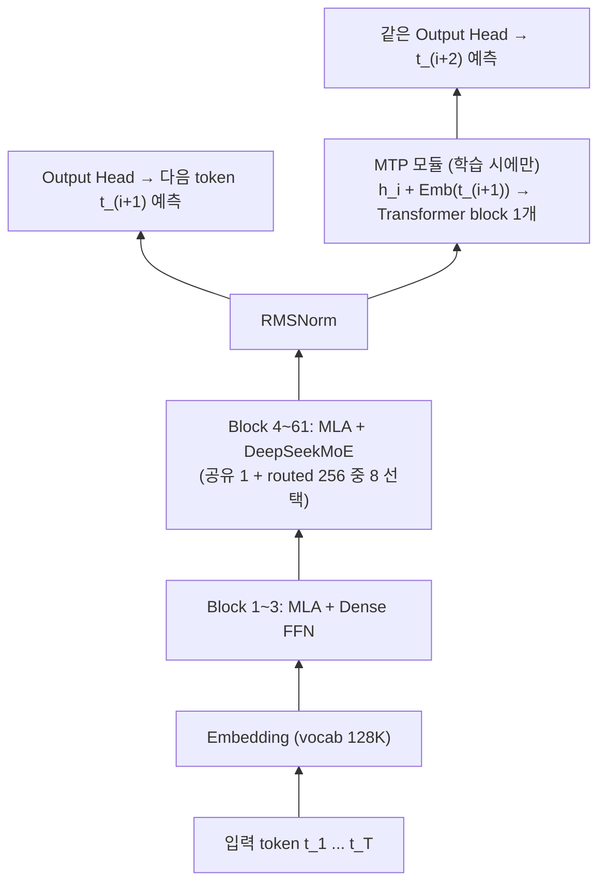
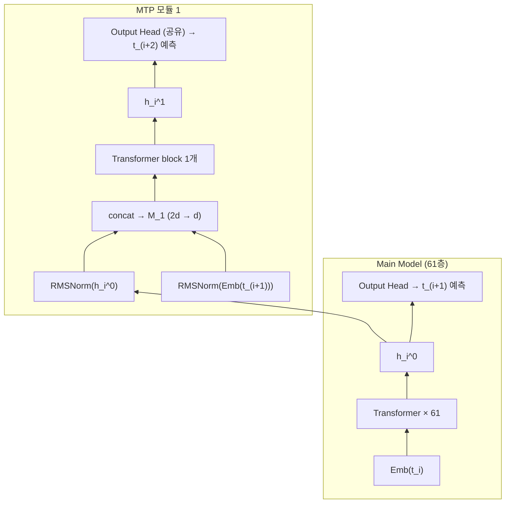
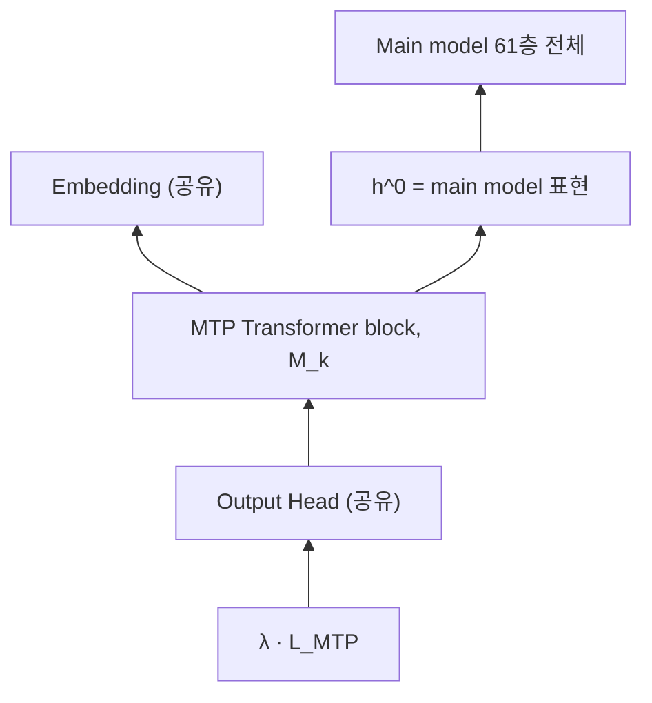
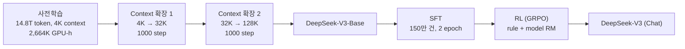
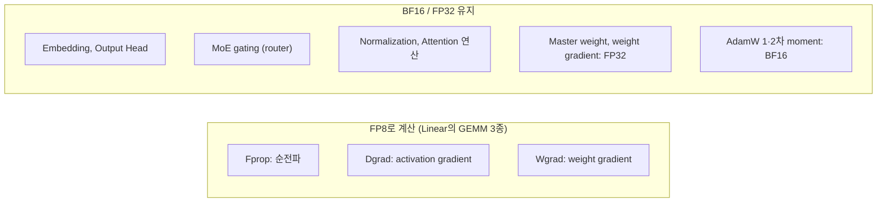
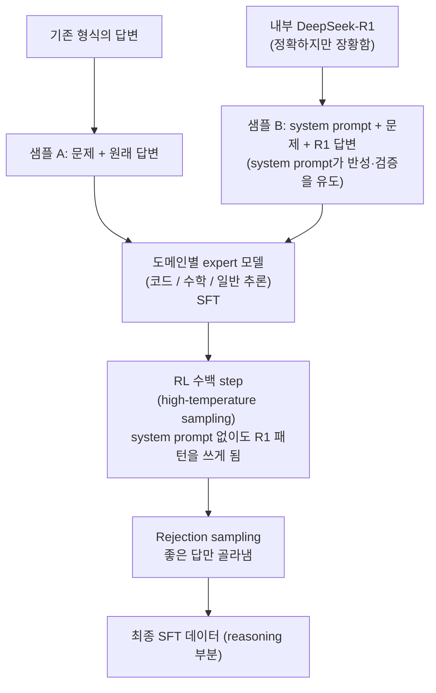

# DeepSeek-V3 Technical Report

## 메타 정보

| 항목 | 내용 |
|------|------|
| 저자 | DeepSeek-AI (기여자 약 200명, 논문 Appendix A에 명단) |
| 소속 | DeepSeek-AI |
| 연도 | 2024 (arXiv, 2024.12) |
| 논문 링크 | [arXiv](https://arxiv.org/abs/2412.19437) |
| 코드 | [deepseek-ai/DeepSeek-V3](https://github.com/deepseek-ai/DeepSeek-V3) · Base / Chat 가중치 공개 (FP8). 이후 학습·추론 인프라도 공개: [FlashMLA](https://github.com/deepseek-ai/FlashMLA), [DeepEP](https://github.com/deepseek-ai/DeepEP), [DeepGEMM](https://github.com/deepseek-ai/DeepGEMM), [DualPipe](https://github.com/deepseek-ai/DualPipe), [EPLB](https://github.com/deepseek-ai/EPLB) |
| 키워드 | MoE, Multi-head Latent Attention (MLA), Auxiliary-Loss-Free Load Balancing, Multi-Token Prediction (MTP), FP8 Training, DualPipe, R1 Distillation |

## 한 줄 요약

> [DeepSeekMoE](../03-deepseekmoe/README.md)와 MLA를 그대로 쓰되, **보조 loss 없이 bias로 부하를 맞추는 routing**과 **다음 2개 token을 예측하는 MTP**를 더한 671B(token당 37B 사용) MoE 모델. **FP8 학습**과 통신을 연산 뒤에 숨기는 **DualPipe**로 14.8T token 사전학습을 H800 278.8만 GPU 시간(약 $5.6M)에 끝냈고, 당시 GPT-4o·Claude-3.5-Sonnet과 비슷한 성능을 냈다.

## 1. 문제의식 / 기존 한계

- **추론 비용 — KV cache:** 표준 Multi-Head Attention(MHA)은 token마다 모든 head의 key·value를 저장해야 한다. 128K context에서는 KV cache가 수백 GB가 되어 batch를 키울 수 없다. GQA·MQA는 cache를 줄이지만 성능이 떨어진다.
- **MoE의 부하 균형과 성능 사이의 충돌:** [Switch](../01-switch-transformers/README.md)·[DeepSeekMoE](../03-deepseekmoe/README.md)는 expert 쏠림(routing collapse)을 막으려고 **보조 loss(auxiliary loss)**를 쓴다. 그런데 이 loss가 크면 language modeling 목표와 싸워서 성능이 떨어지고, 작으면 균형이 안 맞는다.
- **학습 비용 — 통신 병목:** fine-grained expert를 여러 node에 나눠 두면 token을 다른 node로 보내고 받는 all-to-all 통신이 많아진다. DeepSeek-V3 설정에서는 **연산 : 통신 시간이 약 1 : 1**이라, 그대로 두면 GPU가 절반은 통신을 기다린다.
- **수치 정밀도:** FP8은 BF16보다 연산이 2배 빠르고 메모리도 절반이지만, 표현 범위가 좁아 outlier 때문에 초대형 모델 사전학습에서 성공한 사례가 거의 없었다.
- **학습 신호 밀도:** 다음 token 하나만 예측하는 목표는 위치마다 신호가 하나뿐이다.

## 2. 핵심 아이디어

**"DeepSeek-V2에서 검증된 구조(MLA + DeepSeekMoE)는 유지하고, 성능은 학습 목표·routing 개선으로, 비용은 알고리즘·프레임워크·하드웨어를 함께 설계해서 잡는다."**

| 영역 | 아이디어 | 무엇을 푸나 |
|------|----------|-------------|
| 아키텍처 | **MLA** (V2부터) | K·V를 512차원 latent 하나로 압축해 KV cache를 MHA 대비 약 1/57로 줄임 |
| 아키텍처 | **DeepSeekMoE** (V2부터) | 공유 expert 1개 + 작은 routed expert 256개 중 8개 선택 |
| 아키텍처 | **Auxiliary-Loss-Free Load Balancing** (신규) | expert별 bias를 routing에만 더하고, 부하를 보고 bias를 조정. gradient에 간섭하지 않음 |
| 학습 목표 | **Multi-Token Prediction** (신규) | 각 위치에서 다음 token + 그다음 token까지 예측. 학습 신호를 늘리고, 추론 시 speculative decoding에 재활용 |
| 인프라 | **FP8 mixed precision** (신규) | 대부분의 행렬곱을 FP8로. 1×128 / 128×128 단위 세밀한 scaling과 FP32 누적으로 정밀도 유지 |
| 인프라 | **DualPipe + all-to-all 커널** (신규) | forward·backward chunk를 짝지어 통신을 연산 뒤에 숨김. Tensor Parallelism 없이 학습 |
| 사후학습 | **DeepSeek-R1 distillation** (신규) | long-CoT 모델(R1)의 검증·반성 패턴을 V3에 옮기되 출력 길이와 형식은 통제 |

## 3. 모델 아키텍처

### 3.1 전체 구조

decoder-only Transformer다. 각 block은 **MLA(attention) → DeepSeekMoE(FFN)** 순서이고, 둘 다 pre-RMSNorm + residual 구조다. 그 뒤에 학습용 **MTP 모듈 1개**가 붙는다.



<!-- 다이어그램:  — 논문 Figure 2 -->

**모델 하이퍼파라미터 (논문 4.2절, 일부는 공개 `config.json` 기준)**

| 항목 | 값 | 비고 |
|------|----|------|
| 층 수 | 61 | 처음 3층은 dense FFN, 나머지 58층은 MoE |
| hidden 차원 $d$ | 7168 | |
| attention head 수 $n_h$ / head 차원 $d_h$ | 128 / 128 | |
| KV 압축 차원 $d_c$ | 512 | KV cache에 저장되는 latent |
| Query 압축 차원 $d'_c$ | 1536 | 학습 시 activation 메모리 절약용 |
| RoPE용 분리 차원 $d_h^R$ | 64 | head당 |
| MoE expert | 공유 1 + routed 256 | 각 expert 중간 차원 2048 |
| token당 routed expert | 8개 | 최대 4개 node로만 보냄 ($M = 4$) |
| Dense FFN 중간 차원 | 18432 | `config.json` 기준 (논문엔 없음) |
| vocab | 128K (byte-level BPE) | `config.json`: 129,280 |
| MTP 깊이 $D$ | 1 | 다음 token + 1개 더 예측 |
| 초기화 | 표준편차 0.006 | 모든 학습 파라미터 |
| 기타 | 압축 latent 뒤에 RMSNorm 추가, 폭이 좁아지는 곳(width bottleneck)에 scaling factor 곱함 | V2와 동일 |
| **전체 / active 파라미터** | **671B / 37B** | MTP 모듈(약 14B) 제외. HF 공개본은 MTP 포함 685B |

**파라미터 수 검산** (위 설정으로 직접 계산한 근사값)

| 구성 요소 | 계산 | 전체 | token당 active |
|-----------|------|------|----------------|
| Expert 1개 (SwiGLU: 행렬 3개) | $3 \times 7168 \times 2048$ | 44.0M | |
| MoE expert 전체 | 257개 × 58층 × 44.0M | **656B** | 9개 × 58층 × 44.0M ≈ **23.0B** |
| MLA (층당 약 187M) | × 61층 | 11.4B | 11.4B |
| Dense FFN | $3 \times 7168 \times 18432$ × 3층 | 1.2B | 1.2B |
| Embedding + Output Head | $2 \times 129280 \times 7168$ | 1.9B | ~0.9B (head만 연산) |
| **합계** | | **≈ 671B** | **≈ 37B** |

→ 파라미터의 **98%가 expert**에 있고, token은 그중 9/257(약 3.5%)만 쓴다. attention은 전체의 2%도 안 되지만 active 파라미터에서는 약 30%를 차지한다.

#### DeepSeek-V2와 무엇이 달라졌나

| 항목 | DeepSeek-V2 | DeepSeek-V3 |
|------|-------------|-------------|
| 전체 / active | 236B / 21B | 671B / 37B |
| 층 / hidden | 60 / 5120 | 61 / 7168 |
| MLA ($n_h$, $d_c$, $d'_c$, $d_h^R$) | 128, 512, 1536, 64 | 동일 |
| Expert (공유 + routed) / 선택 | 2 + 160 / 6 | 1 + 256 / 8 |
| Expert 중간 차원 | 1536 | 2048 |
| Gate 함수 | Softmax | **Sigmoid + 선택된 것끼리 정규화** |
| 부하 균형 | expert·device·통신 보조 loss 3종 | **bias 조정 (aux-loss-free)** + 아주 약한 sequence 단위 loss |
| Routing 제한 | 최대 3개 device | 최대 4개 node |
| 학습 목표 | next-token | next-token + **MTP** |
| 학습 정밀도 | BF16 | **FP8** |
| 사전학습 token | 8.1T | 14.8T |

### 3.2 Multi-head Latent Attention (MLA)

#### 왜 필요한가: KV cache 크기 비교

생성할 때는 이전 token의 key·value를 저장해 두고 재사용한다(KV cache). 저장해야 하는 원소 수(token당, 층당)를 비교하면:

| 방식 | 저장하는 것 | 원소 수 | V3 설정 대입 |
|------|-------------|---------|--------------|
| MHA | query head마다 전용 K·V (K 128개, V 128개) | $2 n_h d_h$ | 2 × 128 × 128 = **32,768** |
| GQA (group 8) | query head 16개가 K·V 하나씩 공유 (K 8개, V 8개) | $2 n_g d_h$ | 2 × 8 × 128 = 2,048 |
| MQA | 모든 query head가 K 1개·V 1개 공유 | $2 d_h$ | 2 × 128 = 256 |
| **MLA** | 512차원 latent $c^{KV}$ 1개 + 모든 head가 공유하는 64차원 RoPE key $k^R$ 1개 (head별 K·V는 latent에서 복원) | $d_c + d_h^R$ | 512 + 64 = **576** |

- MLA의 cache는 MHA의 **약 1/57**이고, group이 2.25개인 GQA 수준이다. 그런데 V2 논문에 따르면 **성능은 MHA보다 오히려 좋다.**
- 직접 계산하면, 128K token context에서 BF16 KV cache 크기는 MHA 약 **524GB** → MLA 약 **9.2GB** (61층 기준).

#### 수식

**기호:** $h_t \in \mathbb{R}^d$ = $t$번째 token의 attention 입력, $W^{D\cdot}$ = down-projection(압축), $W^{U\cdot}$ = up-projection(복원)

**Step 1. Key·Value를 하나의 latent로 압축 (이것만 cache)**

$$
c_t^{KV} = W^{DKV} h_t \in \mathbb{R}^{d_c} \quad (d_c = 512 \ll d_h n_h = 16384)
$$

$$
[k_{t,1}^C; \dots; k_{t,n_h}^C] = W^{UK} c_t^{KV}, \qquad
[v_{t,1}^C; \dots; v_{t,n_h}^C] = W^{UV} c_t^{KV}
$$

- key와 value가 **같은 latent**에서 복원된다(joint compression). 그래서 cache에는 $c_t^{KV}$ 하나만 저장한다.

**Step 2. 위치 정보는 따로 (Decoupled RoPE)**

$$
k_t^R = \text{RoPE}(W^{KR} h_t) \in \mathbb{R}^{d_h^R}, \qquad
k_{t,i} = [k_{t,i}^C;\ k_t^R]
$$

- $k_t^R$는 **모든 head가 공유**하는 64차원 key다. 이것도 cache한다.

**Step 3. Query도 압축 (학습 메모리 절약용)**

$$
c_t^Q = W^{DQ} h_t \in \mathbb{R}^{d'_c}, \quad
q_{t,i}^C = (W^{UQ} c_t^Q)_i, \quad
q_{t,i}^R = \text{RoPE}(W^{QR} c_t^Q)_i, \quad
q_{t,i} = [q_{t,i}^C;\ q_{t,i}^R]
$$

- query의 RoPE 부분은 head마다 따로 있다(key의 RoPE 부분만 공유).

**Step 4. Attention**

$$
o_{t,i} = \sum_{j=1}^{t} \text{Softmax}_j\!\left(\frac{q_{t,i}^\top k_{j,i}}{\sqrt{d_h + d_h^R}}\right) v_{j,i}^C,
\qquad
u_t = W^O [o_{t,1}; \dots; o_{t,n_h}]
$$

- head당 q·k 차원은 128 + 64 = **192**, v 차원은 **128**이다.

#### 왜 RoPE를 분리했나 (Weight Absorption)

추론할 때 key를 매번 복원하지 않으려면 행렬을 합칠 수 있어야 한다. content 부분의 attention score는

$$
{q_{t,i}^C}^\top k_{j,i}^C = (W^{UQ}_i c_t^Q)^\top (W^{UK}_i c_j^{KV}) = {c_t^Q}^\top \underbrace{({W^{UQ}_i}^\top W^{UK}_i)}_{\text{미리 곱해 둠}} c_j^{KV}
$$

이므로 $W^{UK}$를 query 쪽에 흡수(absorb)하면 **cache된 latent $c_j^{KV}$와 바로 내적**할 수 있다. 같은 방식으로 $W^{UV}$는 $W^O$에 흡수된다.

그런데 RoPE를 key 전체에 적용하면 $W^{UK}$와 $c_j^{KV}$ 사이에 **위치마다 다른 회전 행렬**이 끼어서 미리 곱할 수 없다. 그래서 위치 정보는 64차원짜리 별도 key $k^R$에만 넣고, content key에는 RoPE를 적용하지 않는다. (이 흡수 기법은 V2 논문에서 설명한다.)

### 3.3 DeepSeekMoE + Auxiliary-Loss-Free Load Balancing

#### MoE 층 수식

$$
h'_t = u_t + \sum_{i=1}^{N_s} \text{FFN}_i^{(s)}(u_t) + \sum_{i=1}^{N_r} g_{i,t}\, \text{FFN}_i^{(r)}(u_t)
\qquad (N_s = 1,\ N_r = 256)
$$

$$
s_{i,t} = \text{Sigmoid}(u_t^\top e_i), \qquad
g'_{i,t} =
\begin{cases}
s_{i,t} & s_{i,t} + \color{red}{b_i} \in \text{Topk}(\{s_{j,t} + b_j\},\ K_r) \\
0 & \text{otherwise}
\end{cases},
\qquad
g_{i,t} = \frac{g'_{i,t}}{\sum_j g'_{j,t}}
$$

[DeepSeekMoE 노트](../03-deepseekmoe/README.md)와 비교하면 세 가지가 바뀌었다.

| | DeepSeekMoE (2024.01) | DeepSeek-V3 |
|---|---|---|
| 점수 함수 | $\text{Softmax}$ (256개가 서로 경쟁) | $\text{Sigmoid}$ (expert마다 독립적인 점수) |
| Gate 정규화 | 없음 (합 < 1) | 선택된 8개끼리 합이 1이 되도록 정규화 |
| Top-k 선택 기준 | $s_{i,t}$ | $s_{i,t} + b_i$ (**bias는 선택에만 쓰고 gate 값에는 안 씀**) |

> 공개 추론 코드에서는 정규화한 gate에 `routed_scaling_factor = 2.5`를 추가로 곱한다(논문에는 없음).

#### Auxiliary-Loss-Free: bias로 부하 맞추기

```
매 학습 step이 끝날 때 (batch 전체 기준):
  for 각 expert i:
      if expert i의 부하 > 평균:  b_i ← b_i − γ     # 덜 뽑히게
      if expert i의 부하 < 평균:  b_i ← b_i + γ     # 더 뽑히게
```

- **핵심:** bias $b_i$는 **top-k를 고를 때만** 더한다. 실제 출력에 곱하는 gate 값은 원래 점수 $s_{i,t}$로 계산한다. 그래서 bias는 "누가 뽑히는가"만 바꾸고, **gradient나 출력 크기에는 영향을 주지 않는다.**
- 보조 loss 방식은 "부하를 맞춰라"는 gradient가 language modeling gradient와 섞여서 성능을 깎는다. bias 방식은 gradient 없이 규칙으로만 조정하므로 이 간섭이 없다.
- bias 업데이트 속도 $\gamma$ = 0.001 (처음 14.3T token), 마지막 500B token에서는 0 (bias 고정).
- Sigmoid를 쓰는 이유는 논문에 명시돼 있지 않다. 내 해석: softmax는 256개가 확률을 나눠 가지므로 값이 매우 작고 서로 엮여 있어 bias를 더하기 애매하다. sigmoid는 expert마다 독립적인 점수라 고정된 bias를 더하는 방식과 잘 맞는다.

#### 보조 장치: Sequence 단위 balance loss (아주 약하게)

bias는 **batch 전체**의 부하만 본다. 한 sequence 안에서 극단적으로 쏠리는 것을 막기 위해 매우 작은 보조 loss를 함께 쓴다.

$$
\mathcal{L}_{\text{Bal}} = \alpha \sum_{i=1}^{N_r} f_i P_i, \qquad
f_i = \frac{N_r}{K_r T} \sum_{t=1}^{T} \mathbb{1}(\text{token } t \text{가 expert } i \text{ 선택}), \qquad
P_i = \frac{1}{T}\sum_{t=1}^{T} \frac{s_{i,t}}{\sum_j s_{j,t}}
$$

- $T$는 **한 sequence**의 token 수. $\alpha = 0.0001$ (DeepSeekMoE 16B의 0.001보다 10배 작다).

#### Node-Limited Routing

```
token 하나의 routing 과정 (256 expert = 8 node × 32 expert)

① node별 점수 = 그 node의 expert 중 상위 K_r / M = 8/4 = 2개 점수(s+b)의 합
② 점수 상위 4개 node만 남김
③ 그 4개 node의 expert 128개 중에서 top-8 선택
```

- token이 최대 4개 node로만 가므로 node 간(InfiniBand) 통신량이 제한된다. 공개 코드의 `n_group = 8`, `topk_group = 4`가 이것이다.
- **Token drop 없음:** 학습·추론 모두 capacity를 넘는 token을 버리지 않는다. (Switch Transformer와 대비)

### 3.4 Multi-Token Prediction (MTP)

#### 구조



$$
h_i'^{\,k} = M_k\big[\text{RMSNorm}(h_i^{k-1});\ \text{RMSNorm}(\text{Emb}(t_{i+k}))\big],
\qquad
h^k_{1:T-k} = \text{TRM}_k(h'^{\,k}_{1:T-k}),
\qquad
P^k_{i+k+1} = \text{OutHead}(h_i^k)
$$

- 위치 $i$에서 main model은 $t_{i+1}$을 예측하고, MTP 모듈 1은 **main model의 표현 $h_i^0$ + 정답 token $t_{i+1}$의 embedding**을 받아 $t_{i+2}$를 예측한다.
- **Embedding과 Output Head는 main model과 공유**한다. MTP 모듈 고유의 파라미터는 projection $M_k$와 Transformer block 하나뿐이다.

#### 기존 MTP(Gloeckle et al., 2024)와의 차이

| | Gloeckle et al. (Meta) | DeepSeek-V3 |
|---|---|---|
| 예측 방식 | 독립된 head $D$개가 **병렬로** $t_{i+1}, \dots, t_{i+D}$ 예측 | 모듈을 **순차적으로** 연결 |
| 인과 관계 | $t_{i+2}$를 예측할 때 $t_{i+1}$을 모름 | $t_{i+1}$ embedding을 입력으로 받음 → **완전한 causal chain 유지** |
| 목적 | 학습 + 추론 가속 | 주로 **학습 성능 향상** (추론 가속은 부수 효과) |

#### Loss

**Step 1. 깊이 $k$마다 cross-entropy 하나**

$$
\mathcal{L}_{\text{MTP}}^k
= \text{CrossEntropy}\big(P^k_{2+k:T+1},\ t_{2+k:T+1}\big)
= -\frac{1}{T}\sum_{i=2+k}^{T+1} \log P_i^k[t_i]
$$

| 기호 | 의미 |
|------|------|
| $T$ | 입력 sequence 길이. 입력은 $t_1 \dots t_T$, 정답은 한 칸 밀린 $t_2 \dots t_{T+1}$ |
| $P_i^k$ | 깊이 $k$의 MTP 모듈이 **$i$번째 token 자리**에 대해 낸 확률 분포 (vocab 크기 $V$) |
| $P_i^k[t_i]$ | 그 분포에서 정답 token $t_i$의 확률 |
| $i = 2+k \dots T+1$ | 깊이 $k$가 예측하는 정답 위치. 위치 $j$의 표현으로 $t_{j+k+1}$을 맞히므로, $j = 1 \dots T-k$ → 정답은 $t_{k+2} \dots t_{T+1}$ |

**Step 2. 깊이별 loss를 평균 내고 $\lambda$를 곱한다**

$$
\mathcal{L}_{\text{MTP}} = \frac{\lambda}{D}\sum_{k=1}^{D} \mathcal{L}_{\text{MTP}}^k
\qquad (\text{V3는 } D = 1 \text{ 이므로 } \mathcal{L}_{\text{MTP}} = \lambda \cdot \mathcal{L}_{\text{MTP}}^1)
$$

**Step 3. 전체 학습 loss**

$$
\mathcal{L} = \underbrace{\mathcal{L}_{\text{main}}}_{\text{다음 token}} + \underbrace{\lambda \cdot \mathcal{L}_{\text{MTP}}^1}_{\text{다다음 token}} + \underbrace{\alpha \textstyle\sum_i f_i P_i}_{\text{sequence balance}}
$$

- 논문은 이 합을 한 줄 수식으로 쓰지 않고 "MTP loss를 추가 학습 목표로 쓴다"고만 한다. 위 식은 그 설명을 옮긴 것이다.

#### 예시: $T = 5$, $D = 1$

입력 $t_1 \dots t_5$, 정답 끝은 $t_6$이다.

| 위치 $j$ | Main model 입력 → 예측 | MTP 모듈 1 입력 | MTP 모듈 1 예측 |
|----------|------------------------|-----------------|-----------------|
| 1 | $t_1$ → **$t_2$** | $h_1^0$ + Emb($t_2$) | **$t_3$** |
| 2 | $t_{\le 2}$ → **$t_3$** | $h_2^0$ + Emb($t_3$) | **$t_4$** |
| 3 | $t_{\le 3}$ → **$t_4$** | $h_3^0$ + Emb($t_4$) | **$t_5$** |
| 4 | $t_{\le 4}$ → **$t_5$** | $h_4^0$ + Emb($t_5$) | **$t_6$** |
| 5 | $t_{\le 5}$ → **$t_6$** | (Emb($t_6$)는 입력에 없음) | — |

- Main loss는 5개 항, MTP loss는 **$T - k = 4$개 항**이다.
- 그런데 MTP loss도 $\frac{1}{T} = \frac{1}{5}$로 나눈다($\frac{1}{T-k}$가 아님). 그래서 깊이가 깊을수록 아주 조금 작게 반영된다. $T = 4096$이면 차이는 무시할 수준이다.
- MTP 모듈은 **정답 $t_{j+1}$의 embedding을 입력으로 받는다** (teacher forcing). $t_{j+1}$이 무엇일지 추측할 필요 없이 "$t_{j+1}$이 이미 나왔다면 그다음은?"만 풀면 된다.

#### PyTorch 식 의사코드

```python
# tokens: [B, T+1]  —  tokens[:, j] = t_{j+1}  (0-based 저장)
x, y = tokens[:, :-1], tokens[:, 1:]                # 입력 t_1..t_T / 정답 t_2..t_{T+1}

h0 = main_trunk(embed(x))                           # h^0: [B, T, d]  (61층 통과)
loss_main = F.cross_entropy(out_head(final_norm(h0)).flatten(0, 1), y.flatten())

h_prev, loss_mtp = h0, 0.0
for k in range(1, D + 1):
    h_in   = h_prev[:, : T - k]                      # h^{k-1}_{1:T-k}
    e_in   = embed(tokens[:, k : T])                 # Emb(t_{1+k} .. t_T)      ← embedding 공유
    h_k    = mtp[k].proj(torch.cat([mtp[k].hnorm(h_in),
                                    mtp[k].enorm(e_in)], dim=-1))   # M_k: 2d → d
    h_k    = mtp[k].block(h_k)                       # TRM_k: causal Transformer block (MLA + MoE)
    logits = out_head(mtp[k].norm(h_k))              # P^k                      ← output head 공유
    target = tokens[:, k + 1 : T + 1]                # t_{2+k} .. t_{T+1}
    loss_k = F.cross_entropy(logits.flatten(0, 1), target.flatten(),
                             reduction="sum") / (B * T)   # 1/T 정규화 (T-k 아님)
    loss_mtp += loss_k
    h_prev = h_k                                     # 다음 깊이는 이번 깊이의 표현을 입력으로

loss = loss_main + (lam / D) * loss_mtp + loss_bal
```

- `hnorm`, `enorm`, `norm` 이름은 공개 가중치 파일의 MTP 층 구성(`enorm`, `hnorm`, `eh_proj`, `shared_head.norm`, `shared_head.head`)을 따랐다. 실제 구현은 다를 수 있다.
- `h0`를 `detach()`하지 않는다는 점이 핵심이다 (아래).

#### Gradient는 어디로 흐르나



- MTP loss의 gradient는 MTP 모듈만이 아니라 **공유된 embedding·output head**, 그리고 $h^0$를 거쳐 **main model 61층 전체**로 흘러간다.
- 그래서 main model은 위치 $i$의 표현 $h_i^0$에 "다음 token"뿐 아니라 **"다다음 token을 맞히는 데 필요한 정보"까지** 담도록 학습된다. 논문이 말하는 **"표현을 미리 계획(pre-plan)한다"**가 이 뜻이다.
- 논문은 gradient를 막는다는 언급이 없다. MTP가 main model 성능을 올린다는 ablation 결과(6.3절)도 gradient가 main model로 흘러야 설명된다.

#### 왜 도움이 되나 (논문 주장)

| 효과 | 설명 |
|------|------|
| **학습 신호 밀도 ↑** | 같은 위치에서 정답 2개($t_{i+1}$, $t_{i+2}$)로 학습한다. 같은 데이터에서 더 많은 신호를 뽑아 **데이터 효율**이 좋아질 수 있다 |
| **미리 계획하기** | 다음 token만 맞히면 "당장 그럴듯한 token"에 집중하기 쉽다. 두 칸 뒤까지 맞혀야 하면 문장·코드의 **앞으로의 구조**를 표현에 담게 된다 |

- 실제로 ablation에서 **코드(HumanEval 44.5 → 53.7)·수학(GSM8K 72.3 → 74.0)**처럼 계획이 필요한 과제의 향상이 크고, 지식 과제는 소형 모델에서는 올랐지만(MMLU 50.0 → 53.3) 대형 모델에서는 오히려 조금 떨어졌다(67.5 → 66.6) (6.3절 ①).

#### $\lambda$ 스케줄

| 구간 | $\lambda$ | 같은 시점의 다른 변화 |
|------|-----------|------------------------|
| 0 ~ 10T token | **0.3** | learning rate 2.2e-4 고정 구간 |
| 10T ~ 14.8T token | **0.1** | learning rate cosine 감소 시작 |

- 논문은 이유를 설명하지 않는다. 내 해석: 표현을 크게 만들어 가는 초중반에는 MTP 신호를 강하게 주고, 학습률을 줄이며 마무리하는 후반에는 **실제로 쓰일 next-token 목표**에 더 집중시키려는 것으로 보인다. 추론 때는 main model만 쓰기 때문이다.
- $D = 1$이라 $\lambda$가 곧 MTP loss의 가중치다. 다다음 token은 다음 token보다 맞히기 어려워 $\mathcal{L}^1_{\text{MTP}}$가 $\mathcal{L}_{\text{main}}$보다 크므로, $\lambda = 0.3$이어도 전체 gradient에서 차지하는 비중은 숫자보다 클 수 있다.

#### 학습 비용

| 항목 | 크기 (직접 계산한 근사값) |
|------|---------------------------|
| MTP 모듈 파라미터 | 약 14B (MoE 층 1개: expert 257개 × 44M ≈ 11.3B + MLA + $M_1$). 공개 가중치 685B − 671B와 일치 |
| token당 추가 연산 | Transformer block 1개(active 약 0.6B) + $M_1$(약 0.1B) + output head(약 0.9B) ≈ **1.6B** → main model(37B) 대비 **약 4%** |
| 메모리 | embedding·output head는 main model과 **물리적으로 공유** (5.2절: DualPipe에서 첫 층과 마지막 층을 같은 PP rank에 배치) |

#### 추론할 때

- **버려도 된다:** main model은 MTP 없이 독립적으로 동작한다. 그래서 ablation에서 추론 비용은 완전히 같다.
- **Speculative decoding에 재활용:** MTP가 예측한 두 번째 token의 **채택률(acceptance rate)이 85~90%**이고, 생성 속도(TPS)가 **1.8배**가 된다.

## 4. 데이터셋

### 4.1 사전학습 데이터 (14.8T token)

| 항목 | 내용 |
|------|------|
| 규모 | **14.8T token** (V2: 8.1T) |
| V2 대비 변화 | ① **수학·코드 비율 증가** ② 영어·중국어 외 **다국어 범위 확대** ③ 중복은 줄이고 다양성은 유지하도록 처리 파이프라인 개선 |
| 언어 | 영어·중국어가 대부분 + 다국어 |
| 공개 정도 | 출처·구성 비율·필터링 방법은 **공개하지 않음** |
| Packing | 여러 문서를 이어 붙여 4K sequence를 채움(document packing). 이때 **문서 간 attention mask는 걸지 않음** (cross-sample attention masking 없음) |

#### Fill-in-the-Middle (FIM)

DeepSeek-Coder-V2에서 FIM이 next-token 예측 능력을 해치지 않으면서 "중간 채우기" 능력을 준다는 것을 확인하고 V3에도 적용했다.

```
원본 문서:   [prefix][middle][suffix]

PSM 형식으로 재배열:
<|fim_begin|> prefix <|fim_hole|> suffix <|fim_end|> middle <|eos_token|>
```

- 문서 단위로, packing 전에 적용한다. **전체 문서의 10%**에 적용(rate 0.1).
- 모델은 앞뒤 문맥을 본 뒤 가운데를 생성하는 법을 배운다. 코드 에디터 자동완성 같은 용도에 필요하다.

#### Tokenizer

| 항목 | 내용 |
|------|------|
| 방식 | Byte-level BPE |
| vocab | **128K** |
| 변경점 | 다국어 압축 효율을 높이도록 pretokenizer와 tokenizer 학습 데이터 수정. **문장부호 + 줄바꿈을 합친 token** 추가 |
| 부작용과 해결 | 합친 token 때문에 **token boundary bias** 발생: 마지막 줄바꿈이 없는 여러 줄 prompt(특히 few-shot 평가)에서 모델이 헷갈림. → 학습 중 이런 합친 token의 **일부를 무작위로 쪼개서** 다양한 경우를 보게 함 |

### 4.2 사후학습 데이터

#### SFT 데이터 (150만 건)

| 종류 | 대상 도메인 | 만드는 방법 |
|------|-------------|-------------|
| **Reasoning** | 수학, 코딩 대회, 논리 퍼즐 | 내부 **DeepSeek-R1** 모델로 생성 → 도메인별 expert 모델 → rejection sampling (아래 5.5 참고) |
| **Non-Reasoning** | 창작, 롤플레이, 간단한 QA | **DeepSeek-V2.5**로 답변 생성 → **사람이 정확성 검수** |

- R1이 만든 답은 정확하지만 **생각이 과하고(overthinking), 형식이 엉망이고, 지나치게 길다.** 그래서 R1 답을 그대로 쓰지 않고 "정확도는 R1 수준, 형식과 길이는 일반 답변 수준"이 되도록 가공한다.

#### RL 데이터

- 코딩, 수학, 글쓰기, 롤플레이, QA 등 **다양한 도메인의 prompt**를 사용한다. 구체적인 규모는 공개하지 않았다.
- Reward model 학습용 선호 데이터는 **최종 점수뿐 아니라 그 점수에 이르는 chain-of-thought까지** 포함한다(reward hacking 완화).

## 5. 학습

### 5.1 학습 단계 전체 흐름



Context 확장 두 단계는 합쳐서 119K GPU 시간, SFT + RL은 합쳐서 5K GPU 시간이 들었다.

### 5.2 학습 인프라

#### 클러스터와 병렬화

| 항목 | 내용 |
|------|------|
| GPU | NVIDIA **H800 2,048장** (node당 8장) |
| Node 내부 | NVLink / NVSwitch — **160 GB/s** |
| Node 간 | InfiniBand — **50 GB/s** (NVLink의 약 1/3.2) |
| 프레임워크 | HAI-LLM (자체 개발) |
| 병렬화 | **16-way Pipeline Parallelism** + **64-way Expert Parallelism** (8개 node에 걸침) + **ZeRO-1 Data Parallelism** |
| Tensor Parallelism | **사용 안 함** (메모리 최적화로 필요 없게 만듦) |

- 각 MoE 층의 routed expert 256개는 64개 GPU(8 node)에 **GPU당 4개씩** 고르게 배치된다.

#### DualPipe: 통신을 연산 뒤에 숨기기

문제: cross-node expert parallelism 때문에 **연산 : 통신 ≈ 1 : 1**. 통신하는 동안 GPU가 놀게 된다.

**① chunk 하나를 4 + α 조각으로 나눈다**

| 조각 | 종류 |
|------|------|
| Attention | 연산 |
| All-to-all **dispatch** (token을 expert가 있는 GPU로 보냄) | 통신 |
| MLP (expert 연산) | 연산 |
| All-to-all **combine** (결과를 원래 GPU로 돌려받음) | 통신 |
| PP 통신 (다음 pipeline stage로 전달) | 통신 |

backward는 ZeroBubble처럼 **입력에 대한 gradient(B)**와 **가중치에 대한 gradient(W)**로 다시 나눈다.

**② forward chunk 하나와 backward chunk 하나를 짝지어 겹친다**

```
연산:  [ATTN(F)]       [MLP(B)][MLP(W)]  [MLP(F)]       [ATTN(B)][ATTN(W)]
통신:        [DISPATCH(F)]        [DISPATCH(B)]   [COMBINE(F)]       [COMBINE(B)]
        → 한쪽이 통신하는 동안 다른 쪽이 연산. all-to-all과 PP 통신 모두 완전히 숨겨짐
```

GPU의 SM(연산 유닛)을 통신용과 연산용으로 나누는 비율도 직접 조정한다.

**③ 양방향 pipeline**

micro-batch를 pipeline **양쪽 끝에서 동시에** 넣는다(첫 stage → 마지막 stage 방향과 그 반대 방향). 그래서 위의 forward-backward 짝을 많이 만들 수 있고, bubble도 줄어든다.

| 방법 | Pipeline bubble | 파라미터 메모리 | Activation 메모리 |
|------|-----------------|-----------------|-------------------|
| 1F1B | $(PP-1)(F+B)$ | 1× | $PP$ |
| ZB1P | $(PP-1)(F+B-2W)$ | 1× | $PP$ |
| **DualPipe** | $(\frac{PP}{2}-1)(F\&B+B-3W)$ | **2×** | $PP+1$ |

- 양방향이라 **모델 파라미터를 두 벌** 들고 있어야 하지만, EP가 커서 GPU당 파라미터가 작으므로 부담이 크지 않다.
- micro-batch 수가 늘어도 bubble과 activation 메모리가 늘지 않는다.
- 결과: 모델이 더 커져도 연산 : 통신 비율만 유지하면 **all-to-all 통신 비용을 거의 0으로** 만들 수 있다.

#### Cross-node All-to-All 통신 커널

```
token → [IB] → 대상 node에서 "같은 번호" GPU → [NVLink] → expert가 있는 GPU
```

- 모든 token이 최대 4개 node로만 가도록 제한해서 느린 IB 사용량을 줄인다.
- IB 전송과 NVLink 전달이 완전히 겹친다. NVLink가 3.2배 빠르므로 node당 평균 **3.2개 expert**까지 추가 비용 없이 보낼 수 있다. → 실제로는 8개를 고르지만, 같은 통신 비용으로 **최대 13개(4 node × 3.2)**까지 늘릴 수 있다.
- **SM 132개 중 20개만** 통신에 쓴다. warp specialization으로 IB 송신 / IB→NVLink 전달 / NVLink 수신을 각각 다른 warp가 맡고, 커스텀 PTX 명령으로 L2 cache 오염을 줄인다.

#### 메모리 절약

| 기법 | 내용 |
|------|------|
| 재계산 (Recomputation) | 모든 **RMSNorm**과 **MLA up-projection**은 activation을 저장하지 않고 backward에서 다시 계산 |
| EMA를 CPU에 | 학습률 감소 후 성능을 미리 가늠하려고 파라미터 EMA를 유지하는데, 이를 **CPU 메모리**에 두고 비동기로 업데이트 |
| MTP 공유 파라미터 물리적 공유 | DualPipe에서 가장 얕은 층(embedding)과 가장 깊은 층(output head)을 **같은 PP rank**에 두어, MTP 모듈과 main model이 같은 메모리를 공유 |

### 5.3 FP8 Mixed Precision 학습

#### 무엇을 FP8로, 무엇을 높은 정밀도로



- GEMM은 FP8 입력을 받아 BF16/FP32로 출력한다. 이론상 BF16 대비 **연산 2배**.
- Wgrad가 FP8이므로 backward용 activation도 FP8로 저장할 수 있어 **메모리가 줄어든다.**

#### 정밀도를 지키는 4가지 기법

**① 세밀한 양자화 (Fine-grained Quantization)**

FP8은 표현 범위가 좁아서, 텐서 전체를 하나의 scale로 맞추면 outlier 하나 때문에 나머지 값이 모두 0 근처로 뭉개진다.

| 대상 | 묶음 단위 | 의미 |
|------|-----------|------|
| Activation | **1 × 128 tile** | token 하나의 channel 128개마다 scale 1개 |
| Weight | **128 × 128 block** | 입력 128 × 출력 128 channel마다 scale 1개 |

- outlier의 영향이 작은 묶음 안에만 머문다. NVIDIA Blackwell의 microscaling(MX) 포맷과 같은 발상이다.
- activation gradient도 weight처럼 128×128 block으로 묶었더니 **16B MoE 모델이 300B token 학습 중 발산**했다. activation gradient는 token마다 크기 차이가 커서(token 단위 outlier) block 단위로는 못 잡는다 (Appendix B.2).

**② 누적 정밀도 높이기 (Increasing Accumulation Precision)**

- H800 Tensor Core의 FP8 GEMM은 누적을 **약 14 bit** 정밀도로만 한다. 내적 길이 K = 4096이면 상대 오차가 **최대 약 2%**.
- 해결: Tensor Core에서 **128개 원소(WGMMA 4번)마다** 중간 결과를 CUDA Core의 **FP32 register로 옮겨** 누적한다. 이때 ①의 그룹별 scale도 함께 곱한다(dequantization).
- 한 warpgroup이 옮기는 동안 다른 warpgroup이 MMA를 하므로 Tensor Core 활용률은 유지된다.

**③ 모든 텐서에 E4M3 (Mantissa over Exponents)**

- 기존 방식: Fprop은 E4M3(정밀도↑), Dgrad·Wgrad는 E5M2(범위↑)로 섞어 씀.
- V3: **모두 E4M3**. 작은 묶음마다 scale이 있으니 범위 문제는 ①이 해결하고, 남는 bit를 정밀도(mantissa)에 쓴다.

**④ 온라인 양자화 (Online Quantization)**

- 기존: 이전 iteration들의 최대값 기록으로 현재 scale을 추정(delayed quantization).
- V3: 1×128 tile / 128×128 block마다 **그 자리에서 최대 절댓값을 계산**해 scale을 정한다.

#### 저장·통신도 저정밀도로

| 대상 | 정밀도 | 비고 |
|------|--------|------|
| AdamW 1·2차 moment | **BF16** | 성능 저하 관찰 안 됨 |
| Master weight, gradient 누적 | FP32 | 안정성 |
| 캐시하는 activation | FP8 | 예외 ↓ |
| └ attention 뒤 Linear의 입력 | **E5M6** (자체 포맷) | attention backward에도 쓰여 정밀도에 민감. scale은 2의 거듭제곱 |
| └ MoE SwiGLU 입력 | FP8 저장, 출력은 backward에서 재계산 | |
| MoE dispatch (보내는 activation) | **FP8** | up-projection의 FP8 Fprop과 바로 호환 |
| MoE combine (돌려받는 결과) | BF16 | 정밀도 유지 |

#### 검증

DeepSeek-V2-Lite급(약 16B, 1.33T token)과 V2급(약 230B, 약 0.9T token) 모델에서 BF16과 비교했을 때 **loss 상대 오차가 계속 0.25% 미만**이었다. 학습 무작위성 범위 안이다.

### 5.4 사전학습 하이퍼파라미터

| 항목 | 값 |
|------|----|
| Optimizer | AdamW ($\beta_1 = 0.9$, $\beta_2 = 0.95$, weight decay 0.1) |
| 최대 sequence 길이 | 4K |
| 학습 token | 14.8T |
| Gradient clipping | 1.0 |
| Batch size | 처음 469B token 동안 **3,072 → 15,360** sequence로 점점 증가, 이후 15,360 고정 (≈ 63M token / step) |
| Node 제한 $M$ | 4 |
| Balance loss $\alpha$ | 0.0001 |

**학습 중 바뀌는 값들 (token 기준 타임라인)**

| 구간 | Learning rate | Bias 속도 $\gamma$ | MTP 가중치 $\lambda$ |
|------|---------------|---------------------|----------------------|
| 처음 2K step | 0 → 2.2e-4 선형 warmup | 0.001 | 0.3 |
| ~ 10T | **2.2e-4 고정** | 0.001 | 0.3 |
| 10T ~ 14.3T (4.3T 동안) | 2.2e-4 → 2.2e-5 **cosine 감소** | 0.001 | 0.1 |
| 14.3T ~ 14.633T (333B) | 2.2e-5 고정 | **0 (bias 고정)** | 0.1 |
| 14.633T ~ 14.8T (167B) | **7.3e-6** 고정 | 0 | 0.1 |

- 학습률을 오래 고정했다가 마지막에 줄이는 방식이라, 중간 checkpoint를 재사용하기 쉽다.
- 마지막 500B token에서 bias를 고정해 routing을 안정시킨다.
- **학습이 매우 안정적이었다:** 14.8T token 동안 회복 불가능한 loss spike도, rollback도 없었다.

### 5.5 Long Context 확장 (4K → 128K)

| 항목 | 1단계 | 2단계 |
|------|-------|-------|
| Sequence 길이 | 4K → **32K** | 32K → **128K** |
| Batch size | 1,920 | 480 |
| Step 수 | 1,000 | 1,000 |
| 처리 token (직접 계산) | ≈ 63B | ≈ 63B |
| Learning rate | 7.3e-6 (사전학습 마지막 값) | 7.3e-6 |

- **YaRN** 사용: scale $s = 40$, $\alpha = 1$, $\beta = 32$, attention scaling $\sqrt{t} = 0.1 \ln s + 1$.
- YaRN은 **분리된 RoPE key $k_t^R$에만** 적용한다. MLA에서 위치 정보는 64차원 RoPE 부분에만 있기 때문이다.
- SFT 후 Needle-In-A-Haystack 테스트에서 128K까지 고르게 잘 찾는다.

### 5.6 사후학습 (Post-Training)

#### SFT: R1 distillation 파이프라인



- expert 모델은 RL 과정에서 **R1식 검증·반성 패턴**과 **원래 답의 간결한 형식**을 섞는 법을 배운다. 이 expert를 데이터 생성기로 써서 최종 데이터를 만든다.
- **SFT 설정:** DeepSeek-V3-Base를 **2 epoch** 학습. learning rate는 5e-6 → 1e-6 cosine 감소. 여러 샘플을 한 sequence에 packing하지만 **sample masking으로 서로 보지 못하게** 한다 (사전학습과 반대).

**R1 distillation 효과 (DeepSeek-V2.5로 실험, 논문 Table 9)**

| | LiveCodeBench-CoT | 답변 길이 | MATH-500 | 답변 길이 |
|---|---|---|---|---|
| V2.5 Baseline (짧은 CoT) | 31.1 | 718 | 74.6 | 769 |
| V2.5 + R1 Distill | **37.4** | 783 | **83.2** | **1510** |

성능은 오르지만 답변이 길어진다(수학은 약 2배). 그래서 V3에서는 정확도와 길이 사이의 설정을 골라서 썼다.

#### Reward Model

| 종류 | 대상 | 방법 |
|------|------|------|
| **Rule-based** | 답이 정해진 수학 문제, LeetCode 문제 | 지정 형식(예: box 안)의 최종 답을 규칙으로 채점, 코드는 compiler + test case. **조작이 어려워 가장 신뢰도 높음** |
| **Model-based** (정답 있음) | 자유 형식 정답 | RM이 응답이 정답과 일치하는지 판단 |
| **Model-based** (정답 없음) | 창작 등 | RM이 질문과 답을 보고 점수 |

- RM은 **DeepSeek-V3 SFT checkpoint에서 시작**해 학습한다. 선호 데이터에 점수에 이르는 추론 과정(CoT)을 넣어 reward hacking을 줄인다.
- **Self-Rewarding:** 규칙으로 채점하기 어려운 일반 영역에서는 Constitutional AI 방식으로 **DeepSeek-V3 자신의 투표(voting) 평가 결과**를 보상으로 쓴다. V3는 RewardBench에서 GPT-4o-0806·Claude-3.5-Sonnet-1022 수준이고(87.0), 6번 투표하면 89.6까지 오른다.

#### GRPO (Group Relative Policy Optimization)

PPO는 policy와 같은 크기의 **critic(value) 모델**이 필요하다. 671B 모델이면 critic도 671B다. GRPO는 critic 없이, **같은 질문에 대한 여러 답변의 점수를 서로 비교**해서 baseline을 만든다.

$$
A_i = \frac{r_i - \text{mean}(\{r_1, \dots, r_G\})}{\text{std}(\{r_1, \dots, r_G\})}
$$

$$
\mathcal{J}_{\text{GRPO}}(\theta) = \mathbb{E}\left[\frac{1}{G}\sum_{i=1}^{G}\left(\min\!\left(\frac{\pi_\theta(o_i|q)}{\pi_{\theta_{\text{old}}}(o_i|q)}A_i,\ \text{clip}\!\left(\frac{\pi_\theta(o_i|q)}{\pi_{\theta_{\text{old}}}(o_i|q)}, 1-\varepsilon, 1+\varepsilon\right)A_i\right) - \beta\, \mathbb{D}_{KL}(\pi_\theta \| \pi_{\text{ref}})\right)\right]
$$

- 질문 $q$마다 이전 policy로 답변 $G$개를 생성 → 각각 reward → 그룹 내에서 표준화한 값이 advantage.
- 평균보다 좋은 답의 확률은 올리고, 나쁜 답은 내린다. PPO식 clipping과 reference 모델과의 KL penalty로 너무 멀리 가지 않게 한다.

### 5.7 학습 비용

| 단계 | H800 GPU 시간 | 비용 ($2/GPU-h 가정) |
|------|---------------|----------------------|
| 사전학습 | 2,664K | $5.328M |
| Context 확장 | 119K | $0.238M |
| 사후학습 | 5K | $0.01M |
| **합계** | **2,788K** | **$5.576M** |

- 1T token당 **180K GPU 시간** = 2,048장으로 **3.7일**. 사전학습 전체는 **2개월이 안 걸렸다**(직접 계산: 약 54일).
- **주의:** 이 금액은 최종 학습 1회의 GPU 임대료 환산이다. 아키텍처·알고리즘·데이터 관련 사전 연구와 ablation 실험 비용, 인건비, 클러스터 구매 비용은 **포함되지 않는다.**

### 5.8 (참고) 추론 배포

prefill과 decode를 분리해서 배포한다.

| | Prefill | Decode |
|---|---|---|
| 최소 단위 | 4 node (32 GPU) | 40 node (320 GPU) |
| Attention | TP4 + SP, DP8 | TP4 + SP, DP80 |
| MoE | EP32 | EP320 (GPU당 expert 1개) |
| 부하 균형 | 부하 큰 expert **32개를 중복 배치**, 10분마다 갱신 | 64개 GPU가 중복 expert와 공유 expert 담당 |
| 겹치기 | micro-batch 2개: 한쪽 attention·MoE ↔ 다른 쪽 통신 | 한쪽 attention ↔ 다른 쪽 dispatch + MoE + combine |

decode에서는 공유 expert를 "항상 선택되는 routed expert"처럼 취급해 token당 9개 expert를 고르는 것으로 본다.

## 6. 실험

### 6.1 Base 모델 (논문 Table 3, 일부)

| 항목 | DeepSeek-V2 Base | Qwen2.5 72B Base | LLaMA-3.1 405B Base | **DeepSeek-V3 Base** |
|------|------------------|------------------|---------------------|----------------------|
| 구조 / active / 전체 | MoE / 21B / 236B | Dense / 72B / 72B | Dense / 405B / 405B | MoE / **37B** / 671B |
| Pile-test (BPB) ↓ | 0.606 | 0.638 | **0.542** | 0.548 |
| BBH | 78.8 | 79.8 | 82.9 | **87.5** |
| MMLU | 78.4 | 85.0 | 84.4 | **87.1** |
| MMLU-Pro | 51.4 | 58.3 | 52.8 | **64.4** |
| DROP | 80.4 | 80.6 | 86.0 | **89.0** |
| HellaSwag | 87.1 | 84.8 | **89.2** | 88.9 |
| TriviaQA | 80.0 | 71.9 | 82.7 | **82.9** |
| HumanEval | 43.3 | 53.0 | 54.9 | **65.2** |
| LiveCodeBench-Base | 11.6 | 12.9 | 15.5 | **19.4** |
| GSM8K | 81.6 | 88.3 | 83.5 | **89.3** |
| MATH | 43.4 | 54.4 | 49.0 | **61.6** |
| C-Eval | 81.4 | 89.2 | 72.5 | **90.1** |
| CMMLU | 84.0 | **89.5** | 73.7 | 88.8 |
| MMMLU (비영어) | 64.0 | 74.8 | 73.8 | **79.4** |

- active 파라미터가 11배인 LLaMA-3.1 405B보다 대부분 앞서고, 특히 **코드·수학**에서 차이가 크다.
- 반대로 RACE, PIQA, WinoGrande 같은 일부 영어 독해·상식 과제는 LLaMA-3.1 405B나 V2보다 낮다.

### 6.2 Chat 모델 (논문 Table 6, 일부)

| 항목 | Qwen2.5 72B-Inst | LLaMA-3.1 405B-Inst | Claude-3.5-Sonnet-1022 | GPT-4o-0513 | **DeepSeek-V3** |
|------|------------------|---------------------|------------------------|-------------|-----------------|
| MMLU | 85.3 | **88.6** | 88.3 | 87.2 | 88.5 |
| MMLU-Pro | 71.6 | 73.3 | **78.0** | 72.6 | 75.9 |
| GPQA-Diamond | 49.0 | 51.1 | **65.0** | 49.9 | 59.1 |
| SimpleQA | 9.1 | 17.1 | 28.4 | **38.2** | 24.9 |
| LongBench v2 | 39.4 | 36.1 | 41.0 | 48.1 | **48.7** |
| LiveCodeBench (CoT) | 31.1 | 28.4 | 36.3 | 33.4 | **40.5** |
| Codeforces (백분위) | 24.8 | 25.3 | 20.3 | 23.6 | **51.6** |
| SWE-bench Verified | 23.8 | 24.5 | **50.8** | 38.8 | 42.0 |
| AIME 2024 | 23.3 | 23.3 | 16.0 | 9.3 | **39.2** |
| MATH-500 | 80.0 | 73.8 | 78.3 | 74.6 | **90.2** |
| C-SimpleQA | 48.4 | 50.4 | 51.3 | 59.3 | **64.8** |

- **수학·경쟁 코딩**에서 압도적이다(AIME 39.2, MATH-500 90.2). R1 distillation 효과로 보인다.
- **영어 사실 지식(SimpleQA)**과 **소프트웨어 엔지니어링(SWE-bench)**은 GPT-4o·Claude보다 낮다.

### 6.3 Ablation

**① MTP 효과 (논문 Table 4)** — 추론 시 MTP 모듈을 버리므로 추론 비용은 동일

| 항목 | Small MoE | + MTP | Large MoE | + MTP |
|------|-----------|-------|-----------|-------|
| active / 전체 | 2.4B / 15.7B | | 20.9B / 228.7B | |
| 학습 token | 1.33T | | 540B | |
| BBH | 39.0 | **41.4** | 70.0 | **70.7** |
| MMLU | 50.0 | **53.3** | **67.5** | 66.6 |
| HumanEval | 20.7 | **26.8** | 44.5 | **53.7** |
| GSM8K | 25.4 | **31.4** | 72.3 | **74.0** |
| MATH | 10.7 | **12.6** | 38.6 | **39.8** |

코드·수학처럼 **앞을 내다보고 계획해야 하는 과제**에서 효과가 특히 크다.

**② Aux-loss-free 효과 (논문 Table 5)** — 비교 대상은 같은 sigmoid gate에 보조 loss만 쓴 모델

| 항목 | Small, Aux-Loss | Small, Aux-Free | Large, Aux-Loss | Large, Aux-Free |
|------|-----------------|-----------------|-----------------|-----------------|
| active / 전체, token | 2.4B / 15.7B, 1.33T | | 20.9B / 228.7B, 578B | |
| Pile BPB ↓ | 0.727 | **0.724** | 0.656 | **0.652** |
| BBH | 37.3 | **39.3** | 66.7 | **67.9** |
| HumanEval | 22.0 | **22.6** | 40.2 | **46.3** |
| GSM8K | 27.1 | **29.6** | 70.7 | **74.5** |
| MATH | 10.9 | **11.1** | 37.2 | **39.6** |

**③ 왜 좋아지나: batch 단위 vs sequence 단위 균형 (논문 4.5.3절)**

- 보조 loss(sequence 단위)는 **각 sequence 안에서** 균형을 강제한다. 수학 문서 하나 안에서도 모든 expert를 고르게 써야 하므로, expert가 "수학 전담"이 되기 어렵다.
- bias 방식은 **batch 전체**만 균형이 맞으면 되므로, 도메인별로 expert가 특화될 수 있다. 실제로 Pile의 Wikipedia·Github·DM Mathematics 도메인별 expert 부하를 보면 aux-loss-free 모델이 **훨씬 뚜렷하게 특화**된다(Figure 9).
- 보조 loss를 **batch 단위**로 바꾸면 aux-loss-free와 같은 성능이 나온다:

| 검증 loss | Sequence 단위 보조 loss | Aux-loss-free | Batch 단위 보조 loss |
|-----------|-------------------------|---------------|----------------------|
| 1B MoE | 2.258 | **2.253** | **2.253** |
| 3B MoE | 2.085 | **2.080** | **2.080** |

→ 성능 차이의 핵심은 "loss냐 bias냐"보다 **"균형을 어느 범위에서 맞추느냐"**다.

## 7. 한계점 및 이후 연구

- **한계점 (논문이 밝힌 것)**:
  - **배포 단위가 크다:** 효율적으로 추론하려면 최소 prefill 32 GPU, decode 320 GPU가 필요하다. 작은 팀에는 부담이다.
  - 생성 속도는 V2의 2배 이상이지만 아직 개선 여지가 있다.
- **한계점 (내가 본 것)**:
  - **데이터 비공개:** 14.8T token의 출처, 도메인 비율, 필터링·중복 제거 방법이 없다. "수학·코드 비율을 높였다"는 정성적 설명뿐이라 재현이 불가능하다.
  - **$5.576M의 의미:** 최종 학습 1회의 임대료 환산이다. 실패한 실험, ablation, R1 개발 비용, 클러스터 구매 비용은 빠져 있다.
  - **R1 의존:** 사후학습의 핵심 성능(수학·코드)이 아직 공개되지 않은 내부 R1에서 나온다. V3 자체의 능력과 distillation 효과를 분리해서 보기 어렵다.
  - **하드웨어 종속:** FP8 누적 정밀도 문제(14 bit), SM 20개 통신, IB/NVLink 대역폭 비율 등 많은 설계가 H800 클러스터에 맞춰져 있다.
  - **Ablation 규모:** MTP·aux-loss-free 검증은 최대 228.7B / 540~578B token이다. 671B / 14.8T token에서도 같은 효과인지는 직접 보여주지 않는다.
  - **MTP 깊이:** $D = 1$만 썼다. 더 깊게 하면 어떻게 되는지는 다루지 않는다.
  - **영어 사실 지식 약세:** SimpleQA에서 GPT-4o·Claude보다 크게 낮다.
- **후속 연구**:
  - **DeepSeek-R1 (2025.01):** DeepSeek-V3-Base에 RL을 적용한 reasoning 모델. V3 사후학습에 쓰인 R1의 공개판
  - **DeepSeek-V3-0324, V3.1 (2025):** 같은 구조로 사후학습을 개선. V3.1은 thinking / non-thinking 모드 통합
  - **DeepSeek-V3.2-Exp (2025.09):** DeepSeek Sparse Attention(DSA)으로 긴 context의 attention 비용 감소
  - **Open Infra Week (2025.02):** FlashMLA, DeepEP, DeepGEMM, DualPipe, EPLB 등 이 보고서의 인프라 공개
  - **Kimi K2 (2025):** DeepSeek-V3 구조(MLA + fine-grained MoE)를 거의 그대로 가져와 1T 규모로 확장. MuonClip optimizer 사용
  - MLA를 다른 모델에 이식하는 연구(MHA → MLA 변환), sigmoid gate + bias routing의 다른 MoE 채택 등

## 8. 내 생각 / 의문점

- [DeepSeekMoE](../03-deepseekmoe/README.md)는 expert loss와 device loss를 **둘 다** 신경 써서 설계했는데, V3는 보조 loss를 거의 버렸다. 그런데 4.5.3절을 보면 성능 차이의 원인은 "bias 방식"이 아니라 "batch 단위로 균형을 맞추는 것"이다. 그렇다면 bias 방식의 진짜 장점은 성능보다 **하이퍼파라미터($\alpha$) 조정이 쉬워진다**는 점이 아닐까?
- bias 업데이트는 sign 함수처럼 $\pm\gamma$로만 움직인다. 부하 차이의 크기에 비례해서 움직이면 더 빨리 수렴하지 않을까? 마지막 500B token에서 $\gamma = 0$으로 고정한 것은 학습 막바지에 routing이 흔들리는 것을 막기 위해서로 보인다.
- MLA의 KV cache는 GQA(2.25 group) 수준인데 성능은 MHA 이상이라고 한다. **압축이 오히려 regularization 역할**을 하는 걸까, 아니면 head 수(128)가 많아서 표현력이 보존되는 걸까?
- MTP는 학습 때 Transformer block 1개와 output head를 한 번 더 돌리는 비용이 들지만(token당 연산 약 4%, 3.4절) 추론에서는 공짜다. MMLU는 대형 모델에서 오히려 떨어졌는데(67.5 → 66.6), 지식 과제와 생성·추론 과제에서 MTP 효과가 다른 이유가 궁금하다.
- DualPipe는 "통신 시간을 연산 시간 뒤에 숨긴다"는 발상인데, 연산이 빨라지는 FP8과 함께 쓰면 연산 : 통신 비율이 더 나빠진다. FP8과 DualPipe가 **서로를 필요로 하는 설계**였을 것 같다.
- 사전학습은 문서 간 attention mask 없이 packing하고, SFT는 sample masking을 한다. 사전학습에서는 문서 경계를 넘는 attention이 오히려 도움이 된다는 판단일까?
- 사후학습 비용이 5K GPU 시간(전체의 0.2%)뿐이다. R1을 만드는 비용이 따로 있었다는 점을 고려하면, "강한 teacher가 있으면 사후학습은 싸다"는 것을 보여주는 사례 같다.
